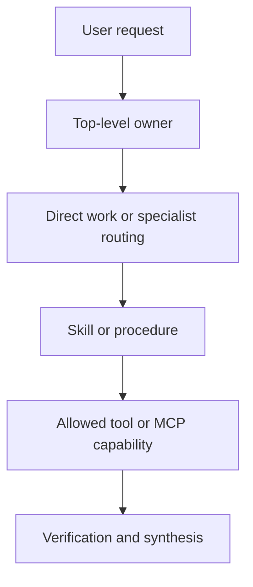
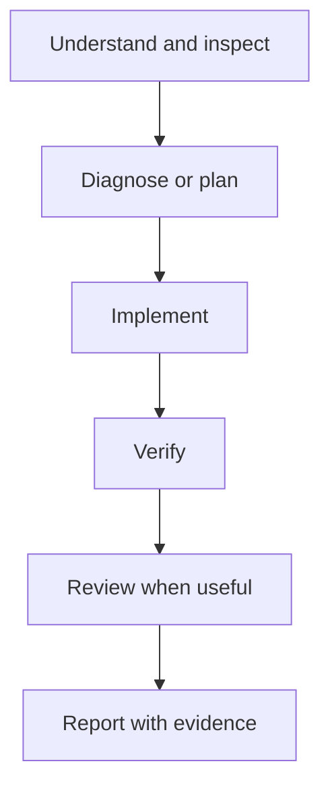

# Copilot User Layer Specification

> **Status:** v2.1 — Two-mode research orchestration configured; validation scope recorded separately
> **Architecture baseline:** v2.1 for intertwined research; native-first engineering retained
> **Operational revision:** v2.1
> **Last updated:** 2026-11-03
> **Primary environment:** VS Code Copilot Agent

Skill delivery revision: local adaptation v2 (2026-10-27); source and static-validation records live in `docs/skill-adaptations.md` and `docs/skill-validation.md`.

User-authorized research-exploration extension (2026-10-28): see §17. This focused interactive entry does not replace Research Investigate or the two orchestration modes.

Approved R2 proposal-delivery and topic-record revision (2026-11-03): guides, entrypoints, workstream contracts, stage Skills and templates are deployed; current rules are summarized in §6.9 and §18. Static contracts and independent content review passed within the [recorded scope](docs/research-orchestration-validation.md#2026-11-03-研究方案与课题记录部署); live user-entry behavior remains unverified. Historical snapshots retain their original scope.

## Current agent-name and path migration

| Historical name | Current name | Current path |
|---|---|---|
| Research Orchestrator | Research Run | `agents/research/entry/research-orchestrator.agent.md` |
| Autonomous Research Orchestrator | Research Auto | `agents/research/entry/autonomous-research-orchestrator.agent.md` |
| Research Investigation Coordinator | Research Investigate | `agents/research/entry/research.agent.md` |
| Research Ideation Partner | Research Explore | `agents/research/entry/research-explore.agent.md` |

This migration changes names, locations and registration paths only; permissions, behavior, models and the call graph are unchanged. Historical snapshots, citations and acceptance evidence retain historical names, while navigation links target current paths. The registration scheme documents the current VS Code host and is not extrapolated to a CLI registry.

## 0. Executive Contract

This document is the single source of truth for the user's personal Copilot Agent environment.

The system supports two top-level work modes:

1. **Engineering**, owned by the native Copilot Agent;
2. **Scientific research**, owned by the user-selected `Research Run` or `Research Auto`.

The architecture is intentionally small. Native capabilities remain the default; custom agents, Skills, and MCP servers are added only when they fill a concrete recurring gap.

The user authorized a two-mode research orchestration architecture for their primary intertwined literature–method–implementation–experiment workload. It supersedes the earlier unapproved v2 candidate and preserves the existing investigation and ideation responsibilities; see §18 and `research-guides/orchestration.md`. Ordinary engineering remains native-first. Capability additions still require a concrete need.

The governing maintenance rule is:

```text
real task
  → observed failure or recurring capability gap
  → identify the responsible layer
  → make the smallest justified change
  → validate the affected route
```

---

# 1. Scope and Boundaries

## 1.1 What “User Layer” Means

The User Layer is the user's cross-project Copilot control plane. It includes reusable behavior, role definitions, workflows, and approved runtime integrations.

It spans more than one physical location:

| Surface | Purpose | In scope |
|---|---|---:|
| `~/.copilot/instructions/` | Cross-project behavioral policy | Yes |
| `~/.copilot/agents/` | Custom roles and delegation topology | Yes |
| `~/.copilot/skills/` | Reusable procedures | Yes |
| `~/.copilot/hooks/` | Optional enforcement | Deferred |
| VS Code User `mcp.json` | Runtime MCP server configuration and secret inputs | Yes, as an integration boundary |
| VS Code extension tool providers | Pylance, Jupyter, Container Tools, and similar native/extension capabilities | Yes, as runtime dependencies |
| Repository `.github/` | Repository facts, commands, architecture, and local policy | No |
| Runtime state, logs, chats, caches, local credentials | Product/runtime data | No |

On the current Windows installation, the MCP configuration is stored in the VS Code user profile rather than under `~/.copilot`.

## 1.2 User Layer vs Repository Layer

The User Layer answers:

> How should my agents work across projects?

The Repository Layer answers:

> How does this specific repository work?

User-level policy may define:

- evidence-first debugging;
- verification before completion;
- research delegation;
- tool-selection principles;
- cross-project safety rules.

It must not assume a specific language, package manager, repository layout, test command, framework, model architecture, or research project. Those facts must be learned from the active repository.

## 1.3 Architecture vs Capability Baseline

These are deliberately separate:

| Baseline | Contains | Change threshold |
|---|---|---|
| Architecture | top-level owners, worker roles, Skill responsibilities, delegation rules | demonstrated role or ownership failure |
| Capability | MCP servers, extension tools, tool exposure, routing guidance | recurring information or execution need |
| Enforcement | Hooks and hard policy gates | clear safety benefit that justifies operational complexity |

Adding an MCP server does not automatically justify a new agent. Changing an agent does not automatically require a new tool.

---

# 2. System Model

## 2.1 Five Control Layers

The environment is organized as five cooperating layers:

| Layer | Question answered | Primary mechanism |
|---|---|---|
| Behavioral policy | How should work be performed? | Instructions |
| Ownership and routing | Who should own or investigate the task? | Native modes and custom agents |
| Reusable method | What procedure should be followed? | Skills |
| Capability | What information or action is available? | Native tools, extension tools, MCP servers |
| Enforcement | What must be blocked or intercepted? | Hooks, if later justified |

The normal control flow is:



Tool availability is not routing policy. A role may be technically able to call a server while its instructions still prohibit an inappropriate operation.

## 2.2 Top-Level Ownership

| Work type | Owner | Rule |
|---|---|---|
| Ordinary software implementation and repository work | Native Agent | Direct-first; delegates selectively |
| Scientific synthesis and authorized intertwined research delivery | `Research Run` or `Research Auto` | Workstream ownership, bounded delegation, project-state integration and final acceptance |
| Repository exploration | Native Explore | Concrete code facts, symbols, call sites, state flow |
| Implementation/diff review | Native Code Review | Reviews code changes, not general reasoning |
| Independent reasoning challenge | Critic | Reviews plans, diagnoses, designs, and validation gaps |

Top-level coordinators are not nested. Either orchestration mode may delegate to Research Investigate, Implementation Lead and Experiment Lead, who delegate only to allowed experts/executors. Implementation Lead owns code delivery inside an authorized research effort; Native Agent owns ordinary engineering. Shared specialists remain directly usable for focused tasks. Research Explore remains user-started only.

---

# 3. Design Principles

## P1. Native First

Use native Copilot capabilities when they already solve the problem:

| Native capability | Primary use |
|---|---|
| Ask | discussion and understanding |
| Plan | planning |
| Agent | implementation and execution |
| Explore | repository exploration |
| Code Review | implementation/diff review |
| Subagent delegation | context isolation and specialized investigation |

Do not create custom Planner, Implementer, Explorer, or Reviewer agents without a demonstrated gap.

## P2. Specialize by Cognitive Responsibility

Custom roles differ by objective, not by academic title:

- Literature Scout maximizes discovery coverage and bibliographic accuracy.
- Evidence Auditor maximizes skepticism toward claim–evidence alignment.
- Experiment Designer maximizes discriminating experimental design.
- Reproducibility Engineer maximizes implementation feasibility and reproducibility.
- Critic maximizes detection of important reasoning weaknesses.

## P3. Skills and Agents Have Different Jobs

Use a Skill for a reusable method. Use a subagent when independent context, a distinct objective, substantial investigation, or context compression materially helps.

## P4. Context Isolation Is a Primary Benefit

Workers should absorb large exploratory traces and return compact, structured findings. The parent should receive evidence, conclusions, conflicts, and uncertainty—not an unfiltered activity log.

## P5. Research Uses Bounded Hierarchical Ownership

The user-selected Research Run or Research Auto owns the full objective; workstream leads organize implementation and experiment delivery; Research Investigate owns scientific investigation and synthesis; experts/executors return scoped evidence. Simple questions may bypass leads. The collaboration protocol is the single source for task contracts, versions, write ownership and budgets.

## P6. Delegation Is Aggressive but Bounded

Default research guardrails: six child calls per round, including leads, nested workers, failures and retries; non-overlapping branch allocations; ready independent work may run in parallel. For batch mode, further rounds require a specific gap, failure, conflict or unlocked dependency. Research Auto inherits topic-scoped default authority (§18), treats the per-round limit as internal fan-out control and continues until the user requests a check/stop, an explicit limit or actual host/resource boundary is reached, research integrity or protection of existing data/processes prevents an action, the task would leave the topic's scope, or no nonrepeating research path remains. Method, candidate-hypothesis and necessary protocol revisions within that scope do not require renewed user approval. Leads never invoke peers, themselves or Research. Critic reviews substantive targets selectively. These are instruction-level bounds, not runtime accounting enforcement.

## P7. Reflection Is Selective

Critic is high value when a concrete plan, diagnosis, design, or synthesis exists. It is not a ritual step for every simple task and not a first-wave discovery worker.

## P8. Bounded Debate Moderator

`Debate Moderator` is an independent, default-off worker for one important
evidence-based dispute. It starts only when the four conditions in the
collaboration plan and Research Investigate instructions are all satisfied.
It does not impose pro/con roles, majority voting, consensus, source edits or
experiment launches. A debate workflow is not required for ordinary tasks.

## P9. Keep the System Explainable

Every added component must answer:

1. What recurring gap exists?
2. Why is a native capability insufficient?
3. Why is this the correct layer to change?
4. What unique responsibility is added?
5. What is the smallest validation that proves value?

## P10. Tool Access Is Deliberate

Prefer local repository evidence before external documentation. Prefer domain-specific authoritative sources over generic browsing. Do not invoke a tool merely because it is available.

## P11. Capability and Permission Are Separate

Exposing an entire MCP server reduces per-tool maintenance, but it does not grant semantic permission to perform every operation. Role instructions constrain when and how server capabilities may be used.

## P12. Failures Are Evidence, Not Answers

A failed query, rate limit, missing identifier, or unavailable API is not evidence that a paper, feature, or fact does not exist. Report the failure, try a suitable alternate route when justified, and preserve uncertainty.

---

# 4. Maintained Component Inventory

## 4.1 Instructions

| File | Role | Status |
|---|---|---:|
| `instructions/engineering.instructions.md` | Cross-project engineering behavior and tool routing | Active; frontmatter validated |
| `instructions/judgment-and-communication.instructions.md` | Evidence-based judgment and Chinese communication | Active |
| `instructions/math-formatting.instructions.md` | Cross-project mathematical formatting | Active |
| `instructions/experiment-comparison.instructions.md` | Task-scoped experiment provenance, input binding, integrity and attribution | Deployed; discovery and runtime behavior require separate evidence |
| `instructions/experiment-execution.instructions.md` | Task-scoped durable experiment execution, logs and GPU policy | Deployed; discovery and runtime behavior require separate evidence |

Experiment policies are user-level Instructions, not new agents or Skills. The engineering instructions explicitly require reading them for relevant tasks even without file attachments; the research collaboration protocol and Experiment Lead/Runner pass the applicable paths to workers. General execution/GPU policy is maintained in the execution instruction; the collaboration protocol adds framework-wide launch ownership and state integration. Repository protocols supply actual paths, inputs, report schemas and tests. Unrelated code review does not trigger experiments or GPU queries, and reading a policy grants no new authority. See [deployment and conflict checks](docs/research-orchestration-validation.md#2026-11-03-用户级实验指令部署与冲突核对).

## 4.2 Agents

```text
agents/
├── core/
│   └── critic.agent.md
└── research/
    ├── entry/
    │   ├── research-orchestrator.agent.md
    │   ├── autonomous-research-orchestrator.agent.md
    │   ├── research.agent.md
    │   └── research-explore.agent.md
    ├── coordination/
    │   ├── implementation-lead.agent.md
    │   ├── experiment-lead.agent.md
    │   └── debate-moderator.agent.md
    ├── specialists/
    │   ├── evidence-auditor.agent.md
    │   ├── experiment-designer.agent.md
    │   ├── experiment-runner.agent.md
    │   ├── literature-scout.agent.md
    │   ├── reproducibility-engineer.agent.md
    │   └── research-implementer.agent.md
    └── inactive/
        └── method-lead.agent.md
```

There are 15 research/core agent files: 14 active, including `agents/core/critic.agent.md`, and one inactive research file. For Research, the user Agent directory registers each of the three active directories separately: `agents/research/entry/`, `agents/research/coordination/`, and `agents/research/specialists/`. The four files in `entry/` are the four research user entries; coordination and specialist files are active allowlist targets, not additional user entries. `agents/research/inactive/` is not registered. Allowlists match exact current agent names, not display labels or fuzzy matches. This describes the current VS Code `chat.agentFilesLocations` arrangement and does not define or imply a CLI registration scheme.

Existing `core/` and `optional/` registration paths are retained unchanged; this migration adds/replaces only the three active Research directory entries and excludes `inactive/`.

## 4.3 Skills

| Skill | Architectural role | Status |
|---|---|---:|
| `systematic-debugging` | Root-cause investigation for unexplained failures | Core; audited PASS WITH PATCH |
| `verification-before-completion` | Completion evidence gate | Core; accepted |
| `paper-reading` | Deep analysis of a concrete paper | Core; integration verified |
| `grill-me` | Intensive questioning and decision pressure-testing | Retained; user- and model-invocable for ambiguous plans, decisions, research ideas, and arguments |
| `discussion` | Maintain a current proposal through inline comments, revisions, decisions and history cleanup | Added; user- and model-invocable; file maintenance follows task authority |
| `research-entry` | Literature-grounded exploration of concrete research entry points | Added; user- and model-invocable |
| `research-question` | Form and check answerable scientific questions | Added; user- and model-invocable |
| `research-hypothesis` | Candidate explanations, predictions, alternatives, and refutation | Added; user- and model-invocable |
| `research-design` | Evidence routes for a discussable research concept | Added; user- and model-invocable |
| `to-tickets` | Turn settled plans into dependency-aware, verifiable work items | Added; user- and model-invocable |
| `code-review` | Read-only review on separate Standards and Spec axes | Added; complements Native Code Review |
| `writing-for-agents` | Write and maintain agent-consumed documents | Added; user- and model-invocable |
| `handoff` | Prepare a verified state packet for a user-invoked handoff | Retained; manual-only |
| `retro` | Evidence-based review of repeated workflow failures and waste | Added; user- and model-invocable |
| `prototype` | Answer a concrete UI, logic, or feasibility question with a small prototype | Added; user- and model-invocable |
| `wayfinder` | Map interdependent unresolved decisions across sessions | Added; user- and model-invocable |
| `paper-reviewer` | Structured paper review | Installed auxiliary capability |
| `scifig-scientific-figure` | Scientific-figure workflow | Installed auxiliary capability |
| `find-skills` | Skill discovery support | Installed auxiliary capability |

Auxiliary Skills are available but are not mandatory dependencies of the Engineering or Research topology.

## 4.4 Hooks

Hooks remain optional and non-blocking. The current architecture does not depend on Hook execution for correctness.

---

# 5. Engineering Layer

**Status:** Native-first for ordinary engineering; research delivery exception defined in §18.

The native Agent owns ordinary engineering tasks and implementation. Implementation Lead is a research workstream role, not a general Engineering Coordinator. It coordinates scoped Research Implementer tasks under Research's project objective and inherited authority.

## 5.1 Engineering Lifecycle



This is not a mandatory full pipeline. Simple work may compress to inspect → edit → targeted verification.

## 5.2 Engineering Routing

| Situation | Route |
|---|---|
| Simple implementation | Native Agent |
| Settled plan needs dependency-aware, verifiable work items | `to-tickets` |
| Repository structure, symbols, call sites, or state flow | Explore |
| Unexplained bug, test, build, runtime, or regression failure | `systematic-debugging` |
| Substantive plan, diagnosis, or design needs independent challenge | Critic |
| Concrete paper understanding affects implementation | `paper-reading` |
| Scientific method must become implementation requirements | Reproducibility Engineer |
| Scientific claim materially affects an engineering decision | Evidence Auditor |
| Need a discriminating scientific validation plan | Experiment Designer |
| Scientific literature is genuinely necessary | Literature Scout |
| Completion is about to be claimed | `verification-before-completion` |
| Existing implementation or diff needs review | `code-review` method; Native Code Review is the available review capability when appropriate |
| User explicitly invokes the handoff Skill | `handoff` (manual-only) |
| Evidence shows repeated agent mistakes, substantial rework, or costly tool waste | `retro` |
| A concrete UI, logic, or technical-feasibility question benefits from a throwaway artifact | `prototype` |
| Interdependent unresolved decisions obscure a large effort's route across sessions | `wayfinder` |
| Agent-consumed guidance or customization files need writing or maintenance | `writing-for-agents` |
| Broad scientific synthesis is the primary task | User explicitly selects Research |

Do not route ordinary engineering work through Research Investigate or either Research orchestration entry.

## 5.3 Engineering Tool Routing

1. Inspect the active repository, dependency files, configuration, and existing implementation first.
2. Use Context7 when current or version-specific library, framework, SDK, or API documentation is required.
3. Prefer documentation matching the dependency version actually used by the repository.
4. Use Hugging Face when work depends on Hub models, datasets, Spaces, repository metadata, or model-specific integration details.
5. For Python projects, use Pylance when workspace-aware import analysis, symbol inspection, type diagnostics, refactoring, debugging, or profiling is relevant.
6. Use Jupyter tools only for actual notebook or kernel tasks.
7. Use Container Tools only when the repository already uses containers, Dev Containers, Dockerfiles, or containerized execution.
8. Do not use Semantic Scholar, arXiv, or Zotero for ordinary engineering tasks unless scientific evidence is materially required.
9. Tool availability never implies mandatory use.

---

# 6. Scientific Research Layer

**Status:** v2 bounded hierarchy; runtime guarantees must be distinguished from configured policy.

## 6.1 Research Topology

The active Research Run or Research Auto owns decomposition, cross-workstream decisions, project-state integration and final acceptance. Research Investigate owns scientific investigation and synthesis; workstream leads own coherent delivery; existing experts keep distinct epistemic responsibilities.

| Role | Primary question | Optimization target |
|---|---|---|
| Research Run | How should a confirmed batch advance and be accepted? | coherent evidence-based delivery within batch authority |
| Research Auto | How should a user-stopped continuous research loop advance and be accepted? | evidence-based progress until user stop/check or a genuine execution boundary |
| Research Investigate | Which scientific findings and judgments are justified? | evidence synthesis and uncertainty handling |
| Implementation Lead | Does actual code implement the method faithfully? | technical integration and verification |
| Experiment Lead | What do protocol-consistent experiments establish? | execution coordination and interpretation |
| Research Implementer | How is this bounded code change implemented and checked? | scoped, faithful implementation |
| Experiment Runner | What actually ran and produced these artifacts? | process, protocol and result provenance |
| Literature Scout | What relevant prior work exists? | coverage, recall, bibliographic accuracy |
| Evidence Auditor | Do the claims follow from the evidence? | skepticism, fairness, confounder detection |
| Experiment Designer | What test would distinguish competing explanations? | discriminating controls, baselines, metrics |
| Reproducibility Engineer | Can the method actually be implemented and reproduced? | concrete requirements, hidden choices, feasibility |
| Critic | What important weakness remains? | independent challenge |
| `paper-reading` | What does this concrete paper actually do? | deep method and evidence understanding |

Native Explore remains available for repository facts.

## 6.2 Research Investigate

Current frontmatter behavior:

```yaml
user-invocable: true
disable-model-invocation: false
```

Maintained coordinator tool set (configured):

```text
vscode + read + edit + search + web + agent + todo
```

The coordinator remains a scientific investigation and synthesis worker, not the end-to-end owner. It may be called by the two orchestration modes and may delegate approved scientific workers, but it does not own implementation, experiment launch or cross-workstream final acceptance. Its `edit` access is for authorized research records only, not source-code implementation. No hard-coded model changes are required.

## 6.3 Literature Scout

Responsibilities:

- discover directly relevant, mechanistically relevant, and contextual work;
- search iteratively across terminology and method families;
- verify title, authors, year, venue/status, and stable identifiers where practical;
- distinguish bibliographic facts, paper claims, interpretation, relevance judgment, and uncertainty;
- return a compact literature map rather than raw result dumps.

Current capability set:

```text
web + search + read
semanticscholar/* + arxiv/* + zotero/*
```

Semantic policy:

- Zotero is read-only for Literature Scout. Do not create, update, delete, attach, annotate, tag, or reorganize items.
- For a known paper title, prefer Semantic Scholar title matching rather than author search.
- For a topic, use paper-search endpoints; use author search only when the input is actually an author.
- Use arXiv metadata and abstracts first; request full text or source only when the task requires it.
- Distinguish preprint year, publication year, and local Zotero metadata instead of silently choosing one.
- Cross-check important bibliographic facts across sources when they disagree.
- Avoid unnecessary parallel API bursts, especially while Semantic Scholar is keyless.

Tool access and live source-routing/read-only guidance are present. Their presence is configuration evidence, not a claim that every provider route was exercised in this delivery.

## 6.4 Evidence Auditor

Focus:

- claim–evidence alignment;
- baseline fairness;
- ablations and controls;
- evaluation protocols;
- leakage, confounders, and statistical support;
- overclaiming and unsupported generalization.

Current capability set:

```text
read + search + web
semanticscholar/* + arxiv/* + zotero/*
```

Academic and Zotero sources are for evidence retrieval and verification. The worker should not modify the Zotero library.

## 6.5 Experiment Designer

Focus:

- hypotheses and competing explanations;
- baselines, controls, and ablations;
- metrics and stopping criteria;
- stress tests and failure analysis;
- experiments that can falsify a mechanism claim.

Current capability set:

```text
read + search + web
context7/* + huggingface/*
```

Context7 and Hugging Face are used only when technical documentation or model/dataset facts materially affect the design.

## 6.6 Reproducibility Engineer

Focus:

- repositories and dependencies;
- data and model requirements;
- compute, memory, and environment constraints;
- configuration and hidden implementation choices;
- concrete reproduction plans and risks.

Current capability set:

```text
read + search + web + execute
context7/* + huggingface/*
```

Execution is used for bounded inspection and validation relevant to reproducibility, not for taking ownership of general implementation.

## 6.7 Critic

Critic is a shared, read-only reasoning worker. It challenges plans, designs, diagnoses, experiments, and syntheses. It does not replace Native Code Review and should not be used merely to inflate worker count.

## 6.8 Canonical Research Routes

| Task shape | Preferred route |
|---|---|
| Broad literature question | Literature Scout → coordinator synthesis; Evidence Auditor or Critic only if needed |
| One concrete paper | `paper-reading`; add Evidence Auditor for claim audit or Reproducibility Engineer for implementation |
| New method design | Literature Scout → Experiment Designer → Reproducibility Engineer → Critic when substantive |
| Existing method evaluation | Evidence Auditor + Experiment Designer; Reproducibility Engineer if implementation feasibility matters |
| Method-to-code translation | Reproducibility Engineer for requirements; Implementation Lead → Research Implementer for authorized delivery |
| Intertwined literature–method–implementation–experiment goal | Research Run/Auto → Research Investigate / relevant workstream leads → scoped experts/executors; project-state feedback loop |
| Authorized experiment execution | Experiment Lead → Experiment Runner; fixed inputs, unique logs and recorded process/exit evidence |
| Strong competing hypotheses | Evidence Auditor + Experiment Designer → coordinator synthesis → Critic |
| Simple bibliographic lookup | Direct minimal call; no full worker roster |

## 6.9 Proposal Delivery and Topic Records — Current R2 Rules

For a complete research concept/proposal or substantive revision, actually read [proposal delivery](research-guides/proposal-delivery.md). It owns the scientific argument: rationale and gap → question → optional subquestions → hypotheses or exploration objectives → method → evidence interpretation, with feasibility, risks and a discriminating next step. Local inquiries, audits, implementation tasks and status reports retain their task scope; uncertain content stays uncertain.

| User entry | Required guide-read trigger |
|---|---|
| Research Explore | Delivering a complete concept or proposal; remains user-started |
| Research Investigate | Asked to design a method or deliver a complete research proposal |
| Research Run | Forming or substantively revising a proposal within its batch scope |
| Research Auto | Initially forming a proposal, substantively revising it, or responding to a user-requested proposal check; routine updates record deltas |

Before reading or writing project records, locate the actual topic using [project records](research-guides/project-records.md); distinguish its code repository/worktree, record directory and run artifacts. Reuse existing paths such as `research/topic-a/` or a custom notes directory. `research/` is only the fallback for a single-topic project without a convention, not a mandatory root. Create substantive records as needed; do not prebuild empty templates or batch-migrate projects.

The project-record guide owns file responsibilities and splitting: brief is the entry; proposal is the scientific argument; a simple method stays there, while an independently reviewable method may use `method.md` or `methods/<method-id>.md` as its single detailed body. Evidence, protocol, implementation mapping and orchestration state have distinct responsibilities and link to that body. [Orchestration](research-guides/orchestration.md) owns topic-aware task packets, revisions and integration: one active root integrates all shared records of the same topic; leads and leaves return scoped artifacts. Without an execution root, the existing topic-record maintainer integrates concept-stage records. Different topic folders do not remove shared-source write conflicts.

Research Investigate synthesizes method definitions, Research Explore forms them during concept development, and the active root/record maintainer integrates them. Implementation Lead and Experiment Lead receive the method contract for implementation and validation. Method Lead remains inactive; names, tools, registration and the call graph are unchanged. Approval, deployment outcome and effective-guide links are recorded in the [discussion result](docs/discussions/research-proposal-and-record-layout.md); original comments remain in its linked archive.

---

# 7. Skill Layer

## 7.1 `systematic-debugging`

Use for unexplained failures, regressions, inconsistent behavior, failing tests, build/runtime errors, and uncertain root causes.

Core behavior:

```text
reproduce → gather evidence → form hypotheses → discriminate → fix root cause → verify
```

The User-Layer version is tool-neutral, platform-neutral, scoped, and cautious around destructive diagnostics.

## 7.2 `verification-before-completion`

Use before claiming engineering work is complete.

Evidence should be:

- fresh;
- relevant to the changed behavior;
- discriminating rather than ceremonial;
- inspectable;
- honestly scoped.

Current worker evidence may be reused when it remains fresh and directly supports the claim. Unverified scope must be reported explicitly.

## 7.3 `paper-reading`

Use for deep analysis of one concrete paper or a small explicitly named set. It replaces the previously considered Scientific Analyst agent and must be invoked through the registered Skill mechanism, not guessed filesystem paths.

## 7.4 `grill-me`

Keep as an intensive questioning workflow available through its slash entry and discoverable by the model when a plan, decision, research idea, or argument is genuinely ambiguous or needs pressure-testing. Its description excludes ordinary direct execution, simple fact lookup, and requests that only need an immediate recommendation. Discovery does not grant permission to edit files, execute a plan, or access external services.

## 7.5 Adapted Engineering and Workflow Skills

All seven adapted Skills provide a user slash entry. `handoff` is manual-only; the other six also allow model discovery. Discovery does not grant extra file-writing, execution, tracker, commit, or push authority; those actions follow the current task and mode. Descriptions are the discovery surface for model-invocable Skills; the entries below document responsibilities rather than mandate a full workflow.

| Skill | Method and boundary | Resources |
|---|---|---|
| `to-tickets` | Convert a settled plan into independently verifiable vertical slices with real, acyclic blockers; unresolved designs stay pending. Large mechanical changes may use expand–migrate–contract. | Per-ticket template; default output is chat, with one file per ticket only when saving is authorized |
| `code-review` | Read-only Standards/Spec review, including logic, regressions, exceptional paths, and data integrity. Covers relevant working changes; unclear baselines are clarified, not guessed. | Review criteria; Native Code Review is an available review capability, while Critic challenges reasoning |
| `writing-for-agents` | Author discoverable, progressively disclosed guidance with clear completion criteria and one source of truth. Use the current host's actual discovery rules. | Copilot skill-mechanics reference; does not take over unrelated engineering |
| `handoff` | Only when the user explicitly invokes the Skill, prepare current state, decision links, change status, matching validation evidence, blockers, and a next action. Delegation needs or context length do not trigger it. | Handoff template; manual-only, with no routine document at every task end |
| `retro` | Investigate evidence of repeated mistakes, substantial rework, or costly tool waste; prefer a few justified improvements at the responsible layer. | Default is advice, not automatic global-policy changes; a one-off failure is insufficient |
| `prototype` | Answer one concrete UI, logic, or technical-feasibility question with the smallest useful artifact and honestly scoped observations. | Three branch references; isolate production state and prototype-only UI, use tests/measurements when the question requires them |
| `wayfinder` | Maintain a destination, decided index, precise open questions and dependencies, unspecified questions, and exclusions when unresolved decisions obscure the route across sessions. | Map and decision templates; settled large implementation belongs in `to-tickets`, not a decision map |

Each adapted Matt Pocock package keeps its own `SOURCE.md` and MIT `LICENSE`; `grill-me` is a separate hiDaDeng-derived package and records its Apache-2.0 repository license and local adaptations in its own `SOURCE.md`. Source details and adaptation versions belong in those per-package records; shared update and rollback policy is indexed in `docs/skill-adaptations.md`. No project artifacts are pre-created by installing templates.

For the 2026-10-27 delivery, the user explicitly waived slash-menu, automatic-trigger, and positive/negative runtime behavior tests. These are recorded as skipped, not passed, and are not release blockers for this delivery. Static structure, references, source, license, and difference checks remain in scope; discovery metadata has already appeared in the current Copilot skill list.

## 7.6 Auxiliary Skills

`paper-reviewer`, `scifig-scientific-figure`, and `find-skills` extend the environment without changing the core architecture. Their presence does not require coordinators to invoke them automatically.

## 7.7 Document-Based Discussion

Use [discussion](skills/discussion/SKILL.md) when maintaining a discussion document through user comments and multiple revisions, or cleaning up resolved threads. The Skill owns the document lifecycle and includes a reusable template; `grill-me` owns pressure-testing, and existing research records remain authoritative for project facts. No new Agent, global instruction or mandatory interview is added. Skill discovery alone does not authorize file edits or implementation. Static installation checks and untested host behavior are recorded in [skill validation](docs/skill-validation.md).

---

# 8. Tool and MCP Capability Layer

## 8.1 Purpose

MCP servers provide capabilities; agents and instructions decide whether those capabilities are appropriate for a task.

The capability stack has four gates:

| Gate | Function |
|---|---|
| Server configuration | Can VS Code start and connect to the provider? |
| Global tool selection | Is the provider available to Copilot sessions? |
| Agent frontmatter | Can this custom role see the server tool set? |
| Behavioral routing | When and how may the role use it? |

A server being “Running” proves connectivity and tool discovery, not correct task routing.

## 8.2 Current Maintained Baseline

| Provider | Type | Primary role | Current status |
|---|---|---|---:|
| Context7 | Remote MCP | Current library/framework/SDK documentation | Running; real documentation query passed |
| Semantic Scholar | Local stdio MCP backed by remote API | Scholarly search, matching, metadata, citation graph | Running keyless; title match passed; rate limit observed; API key pending and non-blocking |
| arXiv | Local stdio MCP | arXiv search, metadata, abstracts, and bounded paper/source retrieval | Running; basic test passed |
| Zotero | Local stdio MCP + local Zotero API | Personal library search, metadata, notes, attachments, and controlled library actions | Running; local API and read-only calls passed |
| Hugging Face | Remote HTTP MCP | Hub models, datasets, Spaces, and repository metadata | Authenticated; tools discovered and available |
| Pylance | VS Code extension tool provider | Python workspace analysis, refactoring, debugging, profiling | Available and usable |
| Jupyter | VS Code extension tool provider | Notebook/kernel inspection and execution | Available and usable |
| Container Tools | VS Code extension tool provider | Container-aware repository work | Available; route only when repository context requires it |

No additional MCP server is justified at this stage. The next work is routing hardening, not inventory expansion.

## 8.3 Whole-Server Exposure

Whole-server references are intentionally used to avoid brittle per-tool lists:

```yaml
'context7/*'
'semanticscholar/*'
'arxiv/*'
'zotero/*'
'huggingface/*'
```

VS Code validates these references against canonical lowercase server identifiers. The display/configuration key in `mcp.json` may retain camelCase, while custom-agent wildcard references use the canonical lowercase form.

Whole-server exposure is accepted only with role-level semantic constraints. In particular, Literature Scout and Evidence Auditor remain read-only toward Zotero even though the server exposes write tools.

## 8.4 Provider Routing Rules

### Context7

- inspect local dependency/version evidence first;
- use when current or version-specific official documentation matters;
- query the actual library and version used by the repository where possible;
- do not use it for facts already clear from local code.

### Semantic Scholar

- known title → title/paper matching;
- topic query → paper search or bulk search;
- author identity query → author search;
- citation relationships → citation/reference tools only when relevant;
- avoid bursty duplicate calls while keyless;
- treat rate limits as provider failures, not negative research results.

### arXiv

- begin with search and metadata/abstract retrieval;
- fetch paper text or source only when deeper analysis requires it;
- keep preprint status distinct from peer-reviewed publication status;
- use bounded retrieval to protect context.

### Zotero

- use the personal library before re-discovering already collected papers;
- read metadata, notes, attachments, and full text only as needed;
- research discovery/audit workers are read-only;
- write operations require explicit user intent or a workflow whose role clearly owns that action;
- Zotero desktop and its local API must be running for local calls.

### Hugging Face

- use for Hub-specific model, dataset, Space, collection, or repository facts;
- do not use it as a generic web search engine;
- never place the bearer token directly in agent files or documentation;
- obtain authentication through the configured VS Code input.

### Pylance, Jupyter, and Container Tools

- Pylance: Python workspace semantics and diagnostics;
- Jupyter: genuine notebook/kernel work only;
- Container Tools: existing containerized workflows only.

## 8.5 Version and Secret Policy

- Rolling latest versions are acceptable for these MCP launchers by default.
- Pin a version only after an actual compatibility or reproducibility problem.
- Secrets belong in secure runtime inputs or environment-backed configuration.
- Never hard-code, print, or copy tokens into agent, Skill, instruction, or specification files.
- The pending Semantic Scholar API key is an optional rate-limit improvement, not a blocker for the current plan.

## 8.6 Failure and Fallback Policy

When an MCP call fails:

1. classify the failure: invalid routing, provider rate limit, authentication, local service unavailable, malformed query, or missing data;
2. correct a clear routing error once;
3. use an alternate authoritative provider when it materially improves confidence;
4. do not convert failure into a factual conclusion;
5. report unresolved uncertainty to the parent agent or user.

---

# 9. Security and Operational Safety

## 9.1 Least Semantic Privilege

Use the minimum capability appropriate to the role, even when a broader server tool set is exposed technically.

Examples:

- Literature Scout may read Zotero but not mutate it.
- Research Investigate delegates rather than collecting every server itself.
- Reproducibility Engineer may execute bounded diagnostics but does not own general implementation.
- Jupyter is not introduced into ordinary projects merely because it is available.

## 9.2 Destructive and External Actions

Do not perform destructive, irreversible, or externally visible actions without clear task authority. Do not enable broad auto-approval for sensitive MCP operations.

## 9.3 Runtime and Secret Isolation

Runtime logs, chat state, caches, local configuration state, credentials, and tokens are not behavioral specification assets. They must remain outside agent prompts and reusable documentation.

## 9.4 Browser Automation

Browser automation is not part of the maintained baseline. Zotero and dedicated scholarly providers cover the current research workflow more directly. Native web access may remain available for targeted external verification when dedicated sources are insufficient.

---

# 10. Verified Evidence and Known Gaps

## 10.1 Verified

- custom endpoint chat, Agent mode, tool calling, and subagent execution work;
- Explore and custom workers execute through the current endpoint;
- Critic works as a shared custom subagent;
- Native Code Review is enabled;
- Research Investigate can route to multiple specialized workers;
- registered `paper-reading` routing works;
- Context7 completed a real current-documentation query;
- Semantic Scholar server started, exposed tools, and matched a paper by title;
- arXiv basic invocation passed;
- Zotero local API, server, recent-item lookup, and item metadata lookup passed;
- Hugging Face authenticated and exposed its tool set;
- Pylance and Jupyter tools are usable;
- the engineering instruction frontmatter is valid and the minimal engineering routing test passed;
- lowercase whole-server references are accepted by VS Code custom-agent validation.

## 10.2 Known Gaps

| Gap | Impact | Blocking? |
|---|---|---:|
| Live provider routing is configured but not exhaustively exercised | Coverage remains task-specific | No |
| Semantic Scholar API key not yet issued | Lower rate limits | No |
| Two user-started roots and full autonomous/debate/recovery behavior remain untested | Lead-to-executor traces and a CPU toy run exist; these do not prove the roots | Partial runtime acceptance; see current validation record |
| Experimental branch exceeded its Agent quota; an Implementer created an unlisted temporary file | Both retained as failures; rules clarified and zero-budget stop retested | Semantic restrictions are not hard enforcement |
| Automatic model escalation and actual model/cost attribution remain unverified | Explicit Sol/Astra requests returned, but execution identity and billing are unavailable | Model-routing acceptance remains partial |
| Hooks are not operational dependencies | No hard interception layer | No |

## 10.3 What Is Not Yet Claimed

This specification does not claim:

- exhaustive MCP benchmarking;
- stable unlimited Semantic Scholar access without a key;
- validation of every tool exposed by each server;
- complete cross-platform equivalence for local Zotero access;
- working safety Hooks;
- repository-specific workflow coverage.

---

# 11. Freeze and Change Policy

## 11.1 Maintained Architecture

The following define the maintained v2 responsibilities:

- Native Agent as ordinary engineering owner;
- Research Run and Research Auto as the two user-selected owners for authorized intertwined delivery;
- Research Investigate as the reusable scientific investigation and synthesis worker;
- Implementation Lead and Experiment Lead plus two scoped executors under the collaboration protocol;
- Literature Scout, Evidence Auditor, Experiment Designer, and Reproducibility Engineer as distinct workers;
- Critic as a shared independent reviewer;
- `paper-reading` as the concrete-paper deep-analysis workflow;
- no top-level coordinator nesting, no peer-lead recursion and bounded lead-to-leaf nesting;
- Debate Moderator as a bounded, default-off dispute workflow;

## 11.2 Evolvable Capability Layer

The following may change with smaller evidence thresholds:

- MCP server versions;
- authentication inputs;
- role-specific tool exposure;
- provider routing text;
- targeted fallback rules;
- extension tool usage guidance.

Capability changes should preserve the maintained ownership model unless the user authorizes a responsibility change.

## 11.3 Change Classification

| Change | Classification | Required validation |
|---|---|---|
| Clarify provider routing | Operational patch | one representative tool-route test |
| Add/remove a role's server wildcard | Capability change | validator check + role-specific smoke test |
| Add a new MCP server | Capability expansion | recurring use case + minimal integration test |
| Add a new worker | Architecture change | demonstrated responsibility gap + overlap review |
| Add a Hook | Enforcement change | invocation proof + false-positive and recovery analysis |

---

# 12. Immediate Next Plan

The approved R2 delivery in §6.9 and §18 is deployed: shared guides, triggered entrypoint reads, topic records and Research Auto default authority are synchronized. Static checks and independent review are recorded separately from untested user-entry behavior. The N1–N5 list below is the prior v1 operational plan, retained as history rather than an instruction to pause delivery for repeated user smoke tests. Live Scout/Auditor and technical-provider guidance already cover its principal text changes; runtime coverage is reported separately.

## N1. Literature Scout Routing Patch — Next

Add the semantic rules already specified in §6.3 and §8.4 to `literature-scout.agent.md`:

1. Zotero read-only boundary;
2. Semantic Scholar title/topic/author endpoint selection;
3. arXiv metadata-first and bounded full-text use;
4. cross-source conflict handling;
5. rate-limit and failed-call semantics.

Validation: one minimal read-only task that starts from a recent Zotero item and verifies it through one appropriate scholarly provider, with no writes.

## N2. Remaining Research Worker Hardening

Apply concise role-specific rules:

- Evidence Auditor: scholarly sources and Zotero are read-only; failed retrieval is not negative evidence.
- Experiment Designer: use Context7/Hugging Face only when documentation or model/dataset facts affect experimental validity.
- Reproducibility Engineer: local repository evidence first; then Context7/Hugging Face for unresolved external facts.

Validation: inspect frontmatter and run only one targeted scenario per changed route if needed.

## N3. Engineering Capability Check

Run one small engineering task that requires local inspection plus exactly one justified external provider. Confirm that ordinary engineering does not invoke academic MCP servers.

## N4. Operational Baseline Review

After N1–N3:

- record observed failures and corrections;
- remove redundant wording;
- mark the MCP routing baseline operational;
- stop expanding the server inventory until another real recurring gap appears.

## N5. Optional Later Work

- add the Semantic Scholar API key when issued;
- reconsider Hooks only after a concrete safety need;
- evaluate cross-platform local-service behavior only when needed;
- create repository-specific layers separately from this specification.

---

# 13. Deferred or Excluded Components

| Component | Decision |
|---|---|
| General Engineering Coordinator | Not added; ordinary engineering remains native |
| Scoped Research Implementer | Added in v2 for delegated scientific implementation; not a replacement for all native engineering |
| Scientific Analyst agent | Rejected; use `paper-reading` |
| Generic Researcher worker | Rejected; responsibility would be too broad |
| Maintained Multi-Agent Debate | Rejected for v1 |
| Unbounded agent swarm or recursive coordinator chains | Excluded; v2 permits a bounded three-level research topology |
| Browser automation MCP | Excluded from current baseline |
| Generic filesystem/memory/database MCP expansion | Excluded without a recurring need |
| Safety Hooks as a blocking dependency | Deferred |
| Semantic Scholar API key | Pending, optional |

---

# 14. Acceptance Criteria

The current User Layer architecture is accepted within the actual validation scope when:

1. ordinary engineering and intertwined research have explicit owners;
2. ordinary engineering remains direct-first;
3. research workers retain distinct cognitive responsibilities;
4. no coordinator cycles exist; research leads may invoke only allowed leaves under inherited authority;
5. Skills represent reusable procedures rather than duplicate roles;
6. MCP servers are treated as capabilities rather than new owners;
7. agent frontmatter uses valid canonical server references;
8. whole-server exposure is paired with semantic role constraints;
9. Zotero discovery/audit routes remain read-only unless explicit authority says otherwise;
10. external documentation follows local repository inspection in engineering;
11. provider failures are reported as failures rather than negative evidence;
12. secrets are supplied through secure runtime inputs and never embedded in prompts;
13. completion claims cite validation actually performed;
14. architecture changes require a demonstrated role-level gap;
15. capability changes require a real use case and targeted validation;
16. the system remains small enough to explain and maintain.

---

# 15. Decision Log

## Architecture Decisions

| ID | Decision | Status |
|---|---|---:|
| D001 | Prefer native Copilot capabilities before custom equivalents | Accepted |
| D002 | Separate cross-project User Layer policy from repository facts | Accepted |
| D003 | Specialize workers by cognitive responsibility | Accepted |
| D004 | Use an orchestrator–worker topology for research | Accepted |
| D005 | Reuse Critic across engineering and research | Accepted and verified |
| D006 | Prefer evidence-oriented workers plus Critic over position-based debate | Accepted |
| D007 | Treat current custom endpoint subagent execution as supported | Verified |
| D008 | Reuse `paper-reading`; do not add Scientific Analyst | Accepted and verified |
| D010 | Research delegation is aggressive but bounded | Accepted |
| D011 | Remove Multi-Agent Debate from maintained v1 | Historical v1 decision; bounded Moderator added in v2.1 |
| D012 | Group agent directories and register roots explicitly | Accepted and verified |
| D013 | Keep Research Coordinator tools focused on coordination | Accepted |
| D014 | Use phase-aware research orchestration | Accepted and smoke-tested |
| D015 | Invoke `paper-reading` through the registered Skill mechanism | Accepted and verified |
| D016 | Freeze Research role architecture at v1 | Superseded for intertwined research by D031 |
| D017 | Share specialist workers across top-level modes without coordinator nesting | Retained for top-level owners; bounded workstream nesting added by D031 |
| D018 | Engineering is direct-first, evidence-driven, and selectively delegated | Accepted |
| D019 | Retain adapted `systematic-debugging` | PASS WITH PATCH |
| D020 | Use `verification-before-completion` as completion evidence gate | Accepted |
| D021 | Keep Hooks optional and non-blocking | Deferred |
| D023 | Freeze overall role architecture at v1 | Superseded in research scope by D031 |
| D031 | Use a user-selected orchestration root → investigation/workstream leads → scoped experts/executors for intertwined scientific delivery | Updated 2026-10-30 to two roots and bounded Moderator; configured, runtime evidence separate |
| D032 | Keep one project-state integration writer, revision-aware task packets and explicit execution provenance | Accepted in collaboration protocol |
| D033 | Complete coherent framework changes before consolidated Agent-run validation; avoid recurring user smoke-test requests | User instruction 2026-10-29 |

## Capability Decisions

| ID | Decision | Status |
|---|---|---:|
| D009 | Literature Scout began with native read/search/web and may expand after evidence | Superseded by D024 |
| D022 | Avoid speculative MCP expansion | Retained as a principle; operational baseline updated by D024 |
| D024 | Add Context7, Semantic Scholar, arXiv, Zotero, and Hugging Face after concrete engineering/research needs emerged | Accepted and implemented |
| D025 | Use whole-server wildcard exposure with role-level semantic constraints | Accepted |
| D026 | Use canonical lowercase MCP server references in custom-agent frontmatter | Accepted and verified |
| D027 | Separate architecture freeze from evolvable capability baseline | Accepted |
| D028 | Treat VS Code User `mcp.json` and extension providers as runtime integration surfaces of the User Layer | Accepted |
| D029 | Keep scholarly discovery/audit access to Zotero read-only by role policy | Accepted; live prompt hardening pending |
| D030 | Default to rolling latest MCP launchers; pin only after a compatibility or reproducibility need | Accepted |

---

# 16. Change Log

Entries below are historical snapshots. Legacy role names in those entries are intentionally preserved; consult the current-name/path migration table at the top for present-day names and locations.

## 2026-11-03 — Approved R2 Document Synchronization

- Synchronized current proposal-delivery triggers, topic-first record navigation, optional single-body method records and same-topic root integration; detailed rules belong to the linked guides.
- Replaced current Research Auto reapproval gates with topic-scoped default research-loop authority, including evidence-based method, candidate-hypothesis and necessary protocol changes. Other modes retain their boundaries.
- Preserved historical decisions, comments, architecture and validation evidence. This entry records changes to the two specification/planning documents, not completion of guide/Agent deployment, a new runtime check or a new experiment.

## 2026-11-03 — Research Agent Name and Path Migration

- Recorded the current Research Run, Research Auto, Research Investigate, and Research Explore names and their `entry/` paths.
- Updated the maintained agent tree and current VS Code registration description to three active Research directories, with `inactive/` excluded; preserved core/optional registration and exact-name allowlists.
- Historical snapshots and acceptance evidence retain old names and results. No role permissions, behavior, models, or call graph changed; static migration checks remain pending parent-level evidence.

## 2026-11-03 — User-Level Experiment Instructions

- Added task-scoped experiment comparison and execution instructions; generalized project-specific paths, metrics and receipt fields instead of copying them into personal policy.
- Added explicit engineering and research worker/protocol pointers; consolidated generic GPU/log/check-cadence rules while retaining framework launch ownership.
- Extended the existing validator to cover user-instruction frontmatter, experiment entry pointers and local links. Static checks do not establish automatic loading in a new session or real execution compliance.

## 2026-11-03 — User-stopped continuous autonomous research

- Changed `Autonomous Research Orchestrator` from finite-batch stopping to a user-stopped continuous research loop: a completed phase, returned branch, temporarily empty ready queue, or exhausted per-round fan-out does not end the loop.
- Kept research-integrity, user-authority, system/workspace safety, explicit user limits, and host-runtime boundaries. A continuing Agent session is not a cross-window daemon; long-running experiments retain independent process and recovery records.

## v2.1 — 2026-10-30

- Configured two user-started orchestration roots and a bounded Debate Moderator; preserved the investigation and ideation entry responsibilities.
- Disabled the unused Method Lead candidate without deleting it; migrated the validator to the approved role names, call graph and three-edge Moderator path.
- Ran static checks, independent review, real Lead-to-executor calls, failure rejection and a fixed-protocol CPU toy run. Recorded quota and temporary-write failures separately from successful run outputs; no blanket runtime pass.
- Added shared model-selection records; explicit Sol/Astra request acceptance does not establish automatic escalation, actual provider attribution or real billing.

## v2.0 — 2026-10-29

- Replaced the two-level investigation-only Research prompt with two-mode orchestration while preserving Research Investigation Coordinator and Research Ideation Partner responsibilities.
- Added Research Orchestrator, Autonomous Research Orchestrator and Debate Moderator; retained Implementation Lead, Experiment Lead, Research Implementer and Experiment Runner. The historical Method Lead candidate is retained but disabled.
- Added one collaboration protocol and project/run templates for authority, dependencies, versions, writing isolation, call allocation and experiment provenance.
- Aligned engineering/experiment-design ownership and removed research-explore's wildcard delegation to preserve its existing same-conversation role.
- The user setting already enables nested Local subagents; no settings, model providers, MCP servers or approval policy were changed. Validation evidence belongs in `docs/research-orchestration-validation.md`.

## 2026-10-28 — Handoff Invocation Policy

- Made `handoff` manual-only: retained the user slash entry and disabled model invocation.
- Restricted its description and body to explicit user invocation; delegation needs no longer trigger the Skill.

## v1.2 — 2026-10-27

Delivery supplement (local adaptation v2):

- Added five missing templates/criteria and their entrypoint pointers, plus per-package `SOURCE.md` records.
- Completed §7 responsibilities and retained only the necessary review-method distinction in global engineering routing.
- Added exact Git ignore exceptions for the two curated maintenance records; other runtime/docs files remain subject to the existing allowlist.
- Recorded the user's runtime-test waiver separately from static validation and product discovery evidence.

- Added seven adapted personal Skills for ticket breakdown, two-axis code review, agent-document authoring, explicit handoff, evidence-based retrospective, scoped prototyping, and decision wayfinding.
- Kept architecture ownership unchanged: Native Agent owns engineering; `code-review` supplies a review method and Native Code Review remains an available execution capability.
- Enabled both user invocation and model discovery for the seven Skills, with narrow descriptions and task-level authorization boundaries.
- Recorded the fixed upstream source, per-skill MIT licenses, adaptation notes, static checks, independent review, and pending new-session behavior validation.
- Updated engineering routing guidance without adding agents, MCP servers, Hooks, or a general-purpose engineering coordinator.

## v1.1 — 2026-09-05

- Reframed the document around a frozen architecture and an evidence-driven capability baseline.
- Expanded scope to include the VS Code User MCP configuration and extension tool providers as runtime integration boundaries.
- Replaced the outdated “academic MCP deferred” state with the actual operational baseline: Context7, Semantic Scholar, arXiv, Zotero, and Hugging Face.
- Added Pylance, Jupyter, and Container Tools routing.
- Documented whole-server wildcard exposure, canonical lowercase references, and semantic role constraints.
- Recorded Zotero read-only policy for Literature Scout and Evidence Auditor.
- Recorded keyless Semantic Scholar operation, observed rate limiting, and the pending non-blocking API key.
- Added provider-specific routing and failure semantics.
- Added the installed auxiliary Skills without making them core architectural dependencies.
- Removed obsolete contradictions from roadmap, open questions, acceptance criteria, and decision history.
- Replaced the completed construction roadmap with an immediate MCP routing-hardening plan.
- Added D024–D030 and marked superseded decisions explicitly.

## v1.0 — 2026-09-03

- Froze Engineering and Research role architecture.
- Established Native Agent and Research Coordinator ownership boundaries.
- Formalized direct-first engineering and bounded, role-aware, phase-aware research delegation.
- Accepted `systematic-debugging` and `verification-before-completion` as core Engineering Skills.
- Verified `paper-reading` and Critic integration.
- Allowed direct access to shared specialist workers without nesting top-level coordinators.
- Deferred Hooks and rejected maintained Multi-Agent Debate.

## v0.3 — 2026-09-02

- Completed and verified Research Layer v1.
- Added grouped agent roots and phase-aware research orchestration.
- Removed Debate from the maintained topology.

## v0.2 — 2026-09-02

- Replaced planned Scientific Analyst with `paper-reading`.
- Established initial Literature Scout tool policy and bounded delegation.
- Added grouped agent-directory design.

## v0.1 — 2026-09-02

- Established the initial User Layer architecture and research worker design.


---

# 17. Research Exploration Extension — 2026-10-28

This section records the historical extension. The role and file-location description below is the 2026-10-28 pre-migration snapshot; legacy names and paths remain historical. Current names and paths are listed in the migration table above and §4.2.

For current proposal-delivery triggers and topic-first record layout, use §6.9 and its linked guides; the fallback paths in this snapshot do not override an existing multi-topic layout. Research Explore remains user-started and its implementation/execution boundary is unchanged.

## Authority and ownership

The user explicitly selected and authorized a personal, cross-project research-exploration setup after a staged requirements interview. This is a scoped concept-formation entry: Research Explore (then named `research-explore`) is manually selected, not a replacement for the investigation coordinator or a general-purpose worker. Its stages remain in one conversation, but after user startup it may explicitly delegate approved scientific investigation workers; the separately authorized two-mode execution topology is described in §18. Do not allow other Agents to invoke this user-started entry.

## Installed components

- `agents/research/entry/research-explore.agent.md`: current file location and name; the original 2026-10-28 snapshot path was `agents/research/research-explore.agent.md`. Research Explore is user-invocable, model invocation disabled, user-started only, and limited to an explicit scientific-worker allowlist. Reads and applies stage methods in the same conversation.
- `skills/research-entry/SKILL.md`, `skills/research-question/SKILL.md`, `skills/research-hypothesis/SKILL.md`, `skills/research-design/SKILL.md`: independently user-invocable and available for relevant model selection. A standalone request only fills necessary upstream gaps.
- `research-guides/concepts.md`, `literature-rules.md`, `interaction-rules.md`, `project-records.md`, and `domains/cmtta.md`: explicit file dependencies; ordinary shared Markdown, not an automatically loaded knowledge system. The Git allowlist admits only Markdown in this folder and keeps later secret exclusions active.

## Agreed behavior and boundaries

Each new research request starts with targeted literature investigation, then a concise evidence report and normally two or three independent questions. Wait for the user's batch response before dependent progression. Follow-up turns in the same investigation reuse valid evidence and search for new gaps. Exploration may revisit stages; the four concepts are not a forced one-way pipeline.

The default deliverable is a discussable research concept: entry point, scientific question, hypotheses when appropriate, an initial evidence route, sources, and unresolved issues. Exploratory work may have no predefined hypothesis. Missing evidence or a rejected direction is a valid outcome. Research implementation and full project scheduling require a separate user request.

After each converged batch, update existing project research records in place; absent a project convention, use `research/brief.md` and `research/evidence.md` when substantive content exists. Preserve decision status separately from evidence status. Changes upstream mark dependent items for review. New sessions resume from the project record. Automatic skill relevance alone is not permission for unrelated writes; honor discussion-only and read-only requests.

CMTTA is the user's audio-video / multi-modal continual TTA domain. Its guide provides conditional protocol questions, not a universal protocol or a preclaimed research gap. Other research domains use their own evidence and project rules. Project-specific findings never become personal global facts automatically.

## Capability and validation boundary

The new role exposes reading, search, web, editing, and the already configured scholarly provider namespaces. Zotero and scholarly-provider access remain semantically read-only. No new MCP servers, model choices, approvals, VS Code settings, Hooks, or worker edits are part of this extension.

Deployment verifies the exact files, Copilot-specific frontmatter, references, and installed checksums. Independent content review can assess the instructions; neither that nor static checks alone proves VS Code/Copilot discovery or end-to-end research behavior. Product runtime status must be reported separately from deployment success.

---

# 18. Intertwined Research Collaboration — 2026-10-29

The user's main workload combines literature, method development, implementation and experiments. They explicitly requested completing the framework before consolidated validation, with Agent-run checks rather than recurring manual validation requests.

The executable instructions and task contract live in [the collaboration protocol](research-guides/orchestration.md); this section records architecture, not a second copy of its operational rules. Research Run and Research Auto own the end-to-end task, Research Investigate owns scientific investigation, two workstream leads organize implementation and experiment delivery, and scoped experts/executors form the bounded worker layer. Debate Moderator handles only qualifying disputes. Direct specialist calls remain appropriate for focused questions.

In the 2026-10-30 validation snapshot, the active Local user settings had `chat.subagents.allowInvocationsFromSubagents: true` and one research agent discovery root; that snapshot did not include the later directory migration. Current directory registration is recorded in §4.2. The usual configured path has two delegation edges; the bounded Moderator path can have three: root → investigation coordinator → Moderator → expert. Leaves lack the agent tool. Runtime discovery and nesting require current traces; do not infer compatibility from filenames or editor validation.

Shared records are ordinary files located per topic under the [project-record rules](research-guides/project-records.md), with all shared bodies integrated by one active root for that topic. Code/worktrees, records and run artifacts may have different roots. No daemon, mailbox, same-worker resume, automatic scheduling/merging or monitoring after session exit is added. The protocol defines explicit re-dispatch from recorded state and a reported flattened route if nested calls are unavailable. Call quotas, file ownership and semantic restrictions are instructions, not a sandbox.

Current Research Auto authority follows [orchestration](research-guides/orchestration.md#自主模式默认执行授权): when the user starts continued autonomous work on an explicit topic, the research loop is authorized by default, including investigation, method adoption, candidate-hypothesis revision, implementation, validation, training/evaluation, necessary controls/ablations, project-specific environment preparation and handling identity-verified processes of this task. Do not request approval per action, proposal or round, or block because an old record omitted action-level permission. Task packets record this default source, topic, inputs and concrete scope for workers to inherit; they are traceability records, not approval queues.

Auto decides evidence-based method, candidate-hypothesis and necessary protocol changes within the topic and records their revisions, reasons, affected evidence and validation. User-specified invariants, prohibitions, limits and stop requests take precedence; actual host permissions, credentials and resource availability still apply. Preserve research integrity, existing user changes/data, historical evidence and unrelated or healthy processes. Do not mix incomparable revisions as same-protocol evidence. Pause only the affected action for a real boundary; this default does not include unrelated topics, unsolicited external messages/publication or destructive task-external effects, and does not extend to Research Run, Research Explore, standalone investigation or a discussion/status request. Framework construction itself does not launch real training. Runs retain fixed inputs, unique logs and existing resource rules; new launches never interrupt existing jobs to obtain devices.

Concentrated validation covers the actual agent files, allowed-edge graph, leaf tool restrictions, reachable references, whitespace checks, independent review and an automated nested-call attempt where available. Static configuration, role execution, actual nested dispatch and full research efficacy are separate claims. See [validation evidence](docs/research-orchestration-validation.md) for what was actually run and what remains unverified; no blanket runtime pass follows from file checks.
