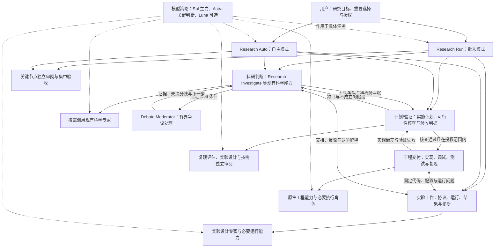

# 科研多 Agent 协作：总体规划与部署路线

更新：2026-11-03。状态：**R2 全案已批准并完成配置部署；静态与独立内容审阅通过，真实用户入口行为仍未验证**。共享 guide、四入口、工作线契约、阶段技能、模板和检查器已同步，名称、工具、调用图与设置未变。既有失败及本次检查边界见[验收记录](research-orchestration-validation.md#2026-11-03-研究方案与课题记录部署)，不将历史运行证据升级为本次行为通过。

本文件集中维护当前架构、部署阶段和待决定事项。它是面向用户的规划，不是 Agent 自动执行指令，不覆盖已有任务权限。首版配置已按本文件写入，但实际调用、模型选择和端到端行为仍以集中验收证据为准。历史用户评注、相关回应和决定演变统一保存在[讨论与决策归档](research-agent-collaboration-discussion.md)中；以后在此更新当前决定及原因，不以聊天中的临时建议直接改运行配置。

Agent 正文审查发现的问题、推荐方案、原因和处理状态统一维护在[内容审查问题清单](agent-content-review.md)；排查或修订 Agent 内容时读取该清单，运行证据仍以验收记录为准。

**阅读与授权边界：** 本文分别记录原始基线、当前事实、已确认决定和候选建议。历史评注和回应见[讨论与决策归档](research-agent-collaboration-discussion.md)，问句不是批准依据。当前名称映射：`Research Orchestrator` → **Research Run**，`Autonomous Research Orchestrator` → **Research Auto**，`Research Investigation Coordinator` → **Research Investigate**，`Research Ideation Partner` → **Research Explore**。四个入口的当前文件均位于 `agents/research/entry/`，工作线位于 `coordination/` 和 `specialists/`，停用角色位于 `inactive/`。历史快照、引文及验收证据保留旧称，导航链接使用新路径。迁移不改变权限、行为、模型或调用图。自主入口的现行默认执行授权见[共享协议](../research-guides/orchestration.md#自主模式默认执行授权)，它不替代批次入口规则。

## 1. 整体 picture

目标是让“文献—方法—计划/验证—实现—实验”围绕同一个研究问题持续反馈：用户确定课题与明确限制，Agent 按所选模式负责分解、调查、执行与证据整合；Research Auto 的课题内科学选择按 §6.1 默认自主决策。优先保证能力，再降低不必要的模型成本；层数和 Agent 数量不是目标。**“计划/验证”环节及“由新 Agent 承担端到端责任”均已由用户确认，首版角色和调用配置已写入；运行行为与模型选择仍待集中验收。**

**当前结论：** 已将“计划/验证”明确加入流程。它把方法转成可执行、可检查的方案，核查修改范围、科学条件、实现判据以及支持或反驳假设的结果；不替代实现后的代码测试和实验取证，也不自动要求新增 Planner。首版由总负责人及现有工作线角色落实。详细原评注与回应见[讨论归档：计划/验证环节](research-agent-collaboration-discussion.md#计划验证环节)。



当前 Agent 文件目录与注册边界如下。basename 保持不变；VS Code 分别注册三个活动 Research 子目录，`inactive/` 不注册；既有 `core/` 与 `optional/` 注册项保留。四个 `entry/` 文件是研究用户入口，其余活动角色按调用白名单供 Agent 使用。

```text
agents/
├── core/
│   └── critic.agent.md
└── research/
    ├── entry/
    │   ├── research-orchestrator.agent.md          # Research Run
    │   ├── autonomous-research-orchestrator.agent.md # Research Auto
    │   ├── research-explore.agent.md               # Research Explore
    │   └── research.agent.md                       # Research Investigate
    ├── coordination/
    │   ├── implementation-lead.agent.md
    │   ├── experiment-lead.agent.md
    │   └── debate-moderator.agent.md
    ├── specialists/
    │   ├── evidence-auditor.agent.md
    │   ├── experiment-designer.agent.md
    │   ├── experiment-runner.agent.md
    │   ├── literature-scout.agent.md
    │   ├── reproducibility-engineer.agent.md
    │   └── research-implementer.agent.md
    └── inactive/
        └── method-lead.agent.md
```

共 15 个 Agent 文件：14 个活动角色（含 Critic）和 1 个停用角色；其中 4 个是 Research 用户入口。此前名称/目录迁移只改变命名、路径及注册说明；本次 R2 更新方案交付、记录布局与 Auto 默认授权规则，角色名称、工具、模型和调用图保持不变。

**图中两个总负责人入口和 Debate Moderator 已写入首版配置；其余为工作职责或已存在角色，具体运行行为仍待验收。** 两个总负责人共享一套流程、专家、Lead、执行者和状态协议，仅授权模式不同：Research Run 处理确认批次；用户启动明确课题的 Research Auto 持续推进时，默认授权该课题研究闭环，明确限制优先，不要求预填全部边界或逐项批准。计划核查、实现测试、实验取证与本框架的集中验收分别回答不同问题，不合并成一次“通过”。

系统需分别设计三件事：

| 设计面 | 要解决的问题 | 不能混为一谈的能力 |
|---|---|---|
| 责任与路由 | 谁调查、谁实施、谁集成、谁接受证据 | 角色层数不等于持续协作 |
| 任务状态与执行 | 如何传递方法条件、代码/协议版本、运行与结果 | 文件记录不等于实时邮箱或自动调度 |
| 模型与成本 | 哪些工作用 Sol，何时值得 Astra | 模型 fallback 不等于按难度自动升级 |

已选方向：以 C 作为完整框架，由新端到端负责人组织科学调查、实现和实验工作线；简单任务允许走更短的调用路径。保留现有科学专家分工，先消除职责/工具/规范矛盾，再明确必要 Lead 和执行者的名单。完整方案先审阅，批准后连续部署，最后集中验收。

| 角色 | 负责交付 | 本轮决定的边界 |
|---|---|---|
| Research Explore（现有） | 通过调查与互动形成切入点、问题、假设或探索目标及初步路线 | 保留构想入口，不扩展为端到端负责人 |
| Research Investigate（现有） | 分解科学调查、组织专家、综合证据、处理分歧并形成科研判断 | 保留调查协调职责，不接管全项目实施和实验推进 |
| Research Run | 在批次授权内接收跨阶段交付、管理依赖与状态、衔接计划/验证并推进下一步 | 批次入口配置已写入；实际调用与端到端行为待验收 |
| Research Auto | 用户启动明确课题持续推进即默认授权研究闭环，自行依据证据调整方法、候选假设与必要协议；可选调度参数不作为启动门槛 | 现行规则见 §6.1；R2 入口/共享协议部署和实际边界执行由主线程验收 |
| Debate Moderator | 组织一个明确争议的独立判断、交叉质询及有界核查，返回证据与未决项 | 角色和触发规则已写入；条件触发、停止及返回行为待验收 |

现有两个 Agent 无固定上下级或强弱排序，均保留用户入口。**已确认并写入调用配置：Research Investigate 可以被其他 Agent 使用；Research Explore 仅由用户主动调用。** 构想入口由用户启动后仍可向外委派调查；限制它被其他 Agent 调用，不等于取消其子代理能力。实际 harness 是否遵循这些配置仍待运行验收；不得把新增总负责人解释成旧入口一律降为子角色。

## 2. 原有基线与当前工作副本

### 2.1 设计基线

修改前 Git 提交：`5a4bac6cfb2cafbf82cc2ea1f08238270949d178`。原始内容需通过此提交读取，不能把当前文件当作原始配置。

原有七个自定义 Agent：

| 角色 | 原有职责 | 原有协作位置 |
|---|---|---|
| Research | 科学调查拆分、委派、冲突处理与证据综合 | 用户可选协调器；直接调用四个领域专家、Critic 和原生 Explore |
| research-explore | 交互式形成切入点、问题、假设和技术路线 | 独立手动入口；同一对话应用四个阶段 Skill，原配置允许子代理 |
| Literature Scout | 文献发现、书目核实与研究地图 | 不再委派的科学专家 |
| Evidence Auditor | 主张与证据关系、公平性、混杂和泄漏 | 不再委派的科学专家 |
| Experiment Designer | 对照、消融、指标及区分性实验设计 | 不运行实验的科学专家 |
| Reproducibility Engineer | 方法到实现要求、状态生命周期与复现风险 | 可做有限诊断，禁止源码修改与长实验 |
| Critic | 对方案、诊断、推理及验证缺口独立挑战 | 工程与研究共享的只读专家 |

Native Agent 负责工程实现；原生 Explore 负责代码调查，两者不计入七个自定义角色。具体论文理解使用 `paper-reading` Skill。原架构已是多 Agent，不缺少角色定义；它主要覆盖分析综合，科研、工程和实验执行的衔接尚未统一。

### 2.2 未经用户审阅的改动：历史快照

前次 Agent 把“先完成框架再集中验证”误作整套新架构的批准，直接改动了工作副本。**这些改动处于待处置状态，不是已接受的 v2 架构；相关文件中“已授权/已接受”的措辞不能作为批准证据。**

| 范围 | 前次候选改动（不代表当前仍全部存在） |
|---|---|
| 三个 Lead | Method Lead、Implementation Lead、Experiment Lead |
| 两个执行者 | Research Implementer、Experiment Runner |
| 原角色 | 大幅改写 Research 的职责/工具/调用入口；改写 Experiment Designer 的实施路由；移除 research-explore 的子代理能力 |
| 通用规则 | 修改工程所有权、总规范和项目记录说明 |
| 支撑文件 | 协作协议、两个模板、检查器、验收记录，以及相应 Git 放行规则 |

本规划创建前的清单为七个已跟踪文件被修改、十个新增文件；这是历史清单，不作为当前恢复清单。此后当前 Research 正文已是原版调查协调流程，用户另行授权了元数据及英文改名，见 §2.3。其余未批准差异继续待处置，不自动回滚，也不作为既定设计扩展。

关于此前“静态通过”和“调用在模型服务预扣费检查处受阻”的说法，**本轮只能确认它们是历史陈述，当前所链接的[验收记录](research-orchestration-validation.md)尚未收录对应命令结果、固定配置版本或原始轨迹**，其“集中检查记录”仍写待更新。暂不把这些说法当作可复核的通过/失败证据，也不据此判断嵌套成功或失败。若找回原始证据，应注明版本、日期与定位；找不到则保留证据缺口，当前方案在阶段 4 独立验收。

### 2.3 构建前文件事实与获准保留项（2026-10-30 历史快照）

本节保留启动构建前的状态，不描述最新配置。构建后：两个旧入口职责保留，Ideation 已恢复显式科学委派，双总负责人和 Moderator 已写入；Implementation/Experiment Lead 与两个执行者纳入首版，Method Lead 保留但关闭用户入口和模型调用。没有整文件回滚或删除旧候选。当前文件以 §6.1 和验收记录为准。

| 范围 | 当前文件事实 | 授权与处置边界 |
|---|---|---|
| 历史路径 `agents/research/research.agent.md`；当前路径 `agents/research/entry/research.agent.md` | 历史显示名为 Research Investigation Coordinator；当前名称为 Research Investigate；描述、输入提示及标题已更新；当前正文保留原版调查协调流程，工具与子角色名单仍为原版配置 | 元数据及英文改名由用户明确要求，必须保留。前次 v2 大幅改写已不在当前文件，不再列为当前待撤回内容 |
| 历史路径 `agents/research/research-explore.agent.md`；当前路径 `agents/research/entry/research-explore.agent.md` | 历史显示名为 Research Ideation Partner；当前名称为 Research Explore；描述、输入提示、标题及直接名称引用已更新；当前仍缺少基线的 `agent` 工具且为 `agents: []` | 获准的描述、输入提示及改名保留；移除子代理的旧候选差异仍待处置，本轮不恢复或批准该差异 |
| 其余旧候选文件 | 仍有三个 Lead、两个执行者、协议/模板/检查器，以及总规范、工程指令、Designer、项目记录和 Git 放行规则的候选差异 | 均未因本轮决定自动获准；新负责人不等于接受旧五个角色或整套 v2 |

本次核对 Git 状态仍有七个已跟踪文件被修改，并有相关新增文件；文件数量不表示具有同一授权状态。阶段 0 必须重新核对当时最新内容，逐项标出“保留已授权修改 / 撤回特定旧差异 / 尚待决定”。原始提交只用来解释历史，不能整文件恢复并覆盖后来获准的修改或其他用户工作。

## 3. 已确认的需求与平台事实

### 用户需求

- 主要工作是文献、方法、实现、实验相互交织的科研任务。
- 重视多 Agent 分工、并行与持续反馈，避免由用户承担所有交接。
- 先看整体图景、部署计划和关键决策，再修改配置。
- 方案批准后完整实施，再集中由 Agent 验证；不要频繁要求用户逐角色、逐步骤手动测试。
- 模型能力优先；Sol 承担大量工作，减少非必要 Astra 使用，Luna 不为微小价差强推。
- 两个现有入口保留，已获准完善描述、输入提示及英文名；未经明确确认不得改变其职责、工具与调用关系。
- 调查协调器可以被其他 Agent 使用，构想伙伴仅由用户主动调用；构想伙伴向外委派调查的能力保留，具体名单与配置待审阅。
- 采用 C 作为完整框架，允许简单任务走更短的调用路径；具体 Lead、执行者及配置待审阅。
- Q1：首版在 VS Code 与 Agent 会话保持开启的场景下运行，不设计无人值守唤醒；实验进程仍须保留运行和退出记录。
- Q2：批次模式与自主模式做成两个可直接选择的总负责人入口；二者共享一套规则，不复制两套流程。
- Q3：模型自动选择、升级与降级属于框架设计；切换必须记录原因、模型和结果，关键审查不能静默降级。
- Q4：首次集中验收使用隔离的小型科研示例，不启动昂贵训练。
- Q5（历史约束，已由 2026-11-03 R2 全案批准替代）：原先限定核心问题/假设不变及评价协议不变。现行 Auto 在明确课题内可依据证据调整方法、候选假设和必要协议，记录版本、原因及证据影响，不逐方案返回用户；用户明确指定不变的条件与禁用信息仍须遵守。
- Q6（历史约束，已由 2026-11-02 放权及 R2 决定修订）：原要求启动前补齐目标、时长、资源、预算、停止条件和禁区。现行 Auto 启动明确课题持续推进即默认授权研究闭环，旧记录未写逐动作许可不构成阻塞；明确限制、停止指令、真实宿主权限和资源、研究诚信及既有数据/进程保护继续生效，详见 §6.1。
- 报告分流：纯工程更正与科研判断分开；不改变科学含义的修复简短汇报，影响状态、数据、指标、协议或结论的修正进入研究主线。
- 端到端责任由新的 Agent 承担，不把现有调查协调器或构想伙伴改为端到端负责人。
- 新增独立 Debate Moderator，由调查协调器按 O06 条件启动，一次处理一个重要争议；不作为必经环节，不接管全局研究、代码实施或实验执行。
- 前期仅授权规划修订；用户随后明确要求开始构建 orchestration。当前按获批双入口 C 框架实施，不将旧候选整套视为批准，也不据此启动真实训练。

### 当前环境与能力边界

| 项目 | 已知事实 / 边界 |
|---|---|
| 子代理数量 | 可多次调用同一角色；文件数不等于可运行实例数 |
| 并行 | VS Code 支持独立子任务并行；当前会话实际并发和服务商容量没有统一固定数值证据 |
| 多层委派 | Local 文档支持开启嵌套，最大五层；此前读取的用户设置已开启，具体链路仍需执行轨迹 |
| 成员持续性 | 本会话接口按一次调用、一次返回工作，没有暴露同 worker 续接或成员邮箱；不泛化成所有 Copilot harness 都不支持 |
| 文件隔离 | 子代理上下文隔离不等于文件隔离；并行源码修改需要独占范围、串行集成或实际 worktree |
| 长实验 | 进程可由调度器/nohup 等机制持续运行；不能据此声称 Agent 会常驻监控 |
| 模型选择 | 支持角色默认模型和单次委派显式模型；角色文件目前未指定固定 model |
| 平台差异 | 当前 runSubagent 路径对应 Local 文档；新的 Copilot harness 使用不同运行时语义，不因产品名称相近就照搬 |

## 4. 原有内容的优化清单与历史审阅范围

本节保留构建前的问题依据与审阅过程；“待审阅范围”是当时状态。当前角色、工具及调用名单已写入，实际验证结论只见[验收记录](research-orchestration-validation.md)，不因本节历史措辞再次要求用户批准已实施事项。

下面将原来的摘要展开为可逐项讨论的建议。**“明确矛盾”表示已在文件中核对到不一致；“设计缺口”表示现有职责不能完整回答目标工作流；“待验证风险”不表示已经发生运行故障。** 所有原文位置均对应第 2.1 节的 Git 基线，行号不是当前工作副本的行号。建议仍待审阅，不授权自动修改配置。

| 编号 | 优先级 / 性质 | 具体议题 | 关联决定 |
|---|---|---|---|
| O01 | 高 / 明确矛盾 | Research 实际开放工具与正文职责不一致 | D04 |
| O02 | 高 / 明确矛盾 | 实现任务被指向禁止改源码的复现专家 | D04、D06 |
| O03 | 高 / 设计缺口 | 方法、计划核查、实现与实验之间没有完整接收责任 | D05、D08 |
| O04 | 中 / 明确矛盾及边界选择 | explore 的通配委派、宽工具与构想入口定位不匹配 | D02、D03a、D03b |
| O05 | 中 / 明确矛盾 | Research 是否可被其他 Agent 调用，文件和规范说法不同 | D02、D04 |
| O06 | 中 / 原有矛盾及已确认新增设计 | 合并重复规则、清理旧 Debate 宣称，设计有条件使用的 Debate Moderator | D04、D06、D10 |
| O07 | 中 / 待验证风险 | 长报告模板可能掩盖小任务真正需要的结论 | 阶段 1 修改包 |
| O08 | 中 / 明确矛盾 | 规范仍把已存在的来源规则记作未实施 | 阶段 1 修改包 |
| O09 | 待核对 / 能力覆盖未知 | Critic 能否完整读取独立审查所需材料 | D04、阶段 4 |

历史评注和回应见[讨论与决策归档](research-agent-collaboration-discussion.md)。后续只在本文记录当前结论、待定问题、依据和稳定索引，不再把整段问答插入每个议题正文。重点仍是是否接受推荐的行为、哪些能力必须保留；工具标识及具体措辞由后续部署清单落实。

### O01：Research 应能做哪些事情，而不只是“有哪些工具”

**当前判断：** 保留 Research Investigate 的调查协调流程；新的端到端能力由新 Agent 承担。`Research Explore` 负责与用户形成构想，`Research Investigate` 负责调查拆分、专家协作和证据综合，二者不构成强弱或固定上下级关系。历史方案中的旧名称保留在对应历史快照中。

**待审阅范围：** 工具应按职责一次性规划，但“配齐工具”不自动批准源码修改、训练或外部写入。具体工具、可写范围及正文/总规范的一致性进入 D04；原始评论和回应见[讨论归档 O01](research-agent-collaboration-discussion.md#o01research-的职责与两个现有入口的边界)。

### O02：复现评估和实际实现应分开归属

**当前判断：** Reproducibility Engineer 交付方法到代码的实施要求、状态生命周期、数据可用性、风险和最小验证方案；获授权的实施者修改源码并提交测试证据。通过后才能按固定协议进入实验。

**待审阅范围：** Designer、复现专家、Native/Implementer 的职责和接收关系需在 D04、D06 中统一；历史回应见[讨论归档 O02](research-agent-collaboration-discussion.md#o02复现评估与实际实现)。

### O03：补齐“方法—计划/验证—实现—实验”的交付和返回责任

**当前判断：** C 框架已选定：新端到端负责人接收跨阶段交付，复杂任务可经过必要 Lead，简单任务允许直接交给合适专家或执行者。方法、计划/验证、实现、实验和研究判断之间必须有明确接收者与失败返回路径。

**待审阅范围：** 具体 Lead、执行者、工具、调用图、状态协议和执行授权仍待 D05、D06、D08 审阅；历史方案比较见[讨论归档 O03](research-agent-collaboration-discussion.md#o03端到端交接与-c-框架)。

### O04：research-explore 保留专家协助，收窄无关执行能力

**当前判断：** Research Explore 仍是用户主动启动的构想入口；启动后可以向外委派科学调查，包括按需使用 Research Investigate。它不承担实现、训练、环境变更或 Git 写操作。

**待审阅范围：** 具体科学专家白名单、工具范围和运行时是否能落实“仅用户调用”进入 D03a、D03b、D04；历史讨论见[讨论归档 O04](research-agent-collaboration-discussion.md#o04research-ideation-partner-的专家协助与工具边界)。

### O05：区分“用户可选”与“其他 Agent 可调用”

**当前判断：** 两个入口都保留用户可选性。Research Investigate 可被其他 Agent 调用；Research Explore 仅由用户主动启动，但启动后仍可向外委派调查。

**待审阅范围：** `user-invocable` 与 Agent 间调用是两个维度，不能只凭一个开关判断。显式名单、通配路径、harness 差异和禁止路径验证进入 D02、D03a、D03b、D04；历史讨论见[讨论归档 O05](research-agent-collaboration-discussion.md#o05用户可选与-agent-间调用)。

### O06：保留科学判断规则，新增有条件使用的 Debate Moderator

**当前判断：** 保留原有科学判断规则，并新增独立 `Debate Moderator`，仅在重要决定、实质分歧、普通核查未解决、质询目标明确四项条件同时满足时启动。它组织独立判断、定向质询和有界核查，按停止条件返回，不强制共识，不改源码、不启动实验，也不反向调用协调器或总负责人。

**待审阅范围：** 具体工具、模型、参与专家、预算、入口配置和部署仍待 D06、D07、D10；历史规则与决定演变见[讨论归档 O06](research-agent-collaboration-discussion.md#o06debate-规则与独立-moderator)。

### O07：让专家回答派工问题，保留深度而不强填报告

**当前判断：** 短任务按问题返回结论、依据、关键限制和下一步影响；完整任务保留角色所需的详细报告结构。相关的状态、泄漏、公平性、竞争解释和判据检查不能因压缩输出而省略。

**待审阅范围：** 具体输出适配规则纳入阶段 1 修改包；历史讨论见[讨论归档 O07](research-agent-collaboration-discussion.md#o07短任务与完整任务的报告深度)。

### O08：更新规范中的实施状态，避免把旧待办重复实施

**当前判断：** O08 是文档一致性维护项，不是新增 MCP 或权限申请。后续区分“规则已写入”“静态已检查”“运行已验证/未覆盖”，没有运行证据就保留证据缺口。

**待审阅范围：** 以最终获批文件为准更新规范和待办，避免重复实施旧事项；详见[讨论归档 O08](research-agent-collaboration-discussion.md#o08规范状态与pending事项)。

### O09：确认 Critic 的取证能力，不先判定 search 不够

**当前判断：** 工具规划一次完成，但 Critic 是否能通过现有 `search` 完整读取计划、源码和证据必须实测后判断。若存在覆盖缺口，只补充只读能力，不默认增加编辑、执行或委派权限。

**待审阅范围：** 纳入阶段 4 的集中验收；当前没有运行证据证明 `search` 的覆盖范围。详见[讨论归档 O09](research-agent-collaboration-discussion.md#o09critic-的材料读取能力)。

### 审阅顺序与本节边界

先看 O01/O04/O05，确定入口和直接能力；再看 O02/O03，确定谁接实施及失败反馈；O06–O09 作为内容质量与取证改进随同审阅。表内 D 编号仍是正式决策索引，本节不新增九个必须逐一批准的关卡。

不将“大量调用”“恰好三层”“三个 Lead”“每轮六次”当作必须满足的指标。现有候选检查器锁定的拓扑也是候选设计，不应用它否决尚待比较的其他方案。

## 5. 模型与成本草案

价格和能力排序来自用户提供，尚未核实输入/输出/缓存 token、币种和服务商折扣口径：

| 模型 | 用户提供单价 | 建议定位 |
|---|---|---|
| gpt6-astra | 3/M | 少量重要研究决策、复杂冲突、关键独立审阅 |
| gpt6.1-sol | 0.6/M | 日常协调、科学分析、实现和一般审阅的默认主力 |
| gpt6-luna | 0.4/M | 明确材料提取、格式整理等可选辅助，不默认承担科学判断 |

在同一计价口径下，Astra 单价为 Sol 五倍，Sol 为 Luna 一点五倍。优先减少不必要 Astra 调用，同时控制重复上下文、重复审查与返工；并行通常缩短等待时间，不自动降低总成本。

建议所有原有科学专家默认 Sol，Research Investigate/Research Explore 的常规工作也默认 Sol；核心方向取舍、方法有效性争议、难解实现问题或重要结论复审再考虑 Astra。角色名字不决定难度，同一个角色按任务也可以选择不同模型。Luna 暂不需要固定科研角色。

新端到端负责人的模型须单独纳入完整模型表，目前尚未确定其默认值或升级策略，不能自动沿用旧 B 将 Research 作为主线时的假设。

部署前要核实：

1. 当前会话可用的精确模型标识符及 provider，不把用户口头名称直接写入配置。
2. 主模型成本档位与子模型选择检查对该自定义提供商的实际影响：官方 Local 文档限制显式选用超过主模型档位的子模型；尚不能保证 Sol 主会话可直接调用 Astra。
3. Local 选择顺序为显式委派模型 → 角色 model → 适用时 Auto → 主模型；BYOK 默认继续使用其模型，不能指望 Auto 自动替其省钱。
4. model 数组选择第一个可用项，不表示“难度高则升级”或“质量不够自动重试”。升级条件与花费上限需要单独设计。
5. 若支持便宜主模型调用 Astra，采用 Sol 主线按需升级；若不支持，比较关键阶段切主模型、预设强主线而子任务固定 Sol 等路径的成本与复杂度，不预先改模型服务。

## 6. 分阶段部署计划

阶段 0–2 的步骤保留为设计与授权历史；当前已完成配置构建，进入阶段 4 的部分验收。§6.1 描述当前首版配置，模型执行及剩余运行边界以验收记录为准。旧步骤中的“待批准”不撤销用户后续的构建授权。

### 阶段 0：审阅基线与旧改动处置

**目标：** 先让工作副本和被认可的架构一致，消除候选改动继续影响日常行为的歧义。

**部署步骤（获批后执行）：**

1. 重新读取 Git 状态，以 §2.3 为上一份事实快照，对照基线、当前内容与授权来源，逐项列出精确恢复/保留差异。
2. 保留获准的两个英文名称、描述、输入提示、标题及直接名称引用；仅建议撤回尚未批准的旧候选差异。Research 当前已是原版调查协调正文，不再整份列为待恢复 v2。新增候选不能一边称“冻结”一边被视为正式角色使用。
3. 恢复只针对确认的旧差异；构想伙伴被移除的子代理能力与其他候选分别列项，新增文件先确定移出发现目录还是删除。不以整文件 checkout 或整仓库 hard reset/clean 覆盖获准修改及后来用户工作。
4. 完成后报告角色清单、差异和保留文件。不自动提交/推送。

**需要用户确定：** D01：未批准旧差异的逐项处置及是否保留旧验收材料。已批准的改名和元数据必须保留；新负责人按新设计另行部署，不从旧 v2 自动选用。

**交付/验收：** 精确变更清单与恢复结果；此阶段只核对基线，不做反复角色测试。

### 阶段 1：优化原有 Agent 内容与边界

**目标：** 在明确获批的差异范围内修正原角色不一致，保留两个入口职责，不把调查协调器改为端到端负责人。新角色设计放在阶段 2。

**部署步骤：**

1. 为七个原角色形成一页职责矩阵：输入、判断范围、交付、工具、允许调用者/子角色、停止与上报条件。
2. 按第 4 节 O01–O09 拟定逐文件差异，分别标明明确矛盾、待选边界和待验证风险；对 Research 建立保留/合并/迁移/删除表，保护原有科学方法规则。
3. 按已确认调用方向提出具体名单与工具范围：调查协调器可被其他 Agent 使用，构想伙伴仅用户启动且可向外委派调查；检查其他角色的名单和通配路径不会调用构想伙伴。统一 Designer/复现评估者/Native 的职责，将旧 v2 工程所有权说明列入待校正项。配置改动先进入审阅包。
4. 用户审阅完整修改包后集中修改；如与阶段 2 同时获批，可连同整体部署执行，避免多次来回验收。

**已确认 / 待确定：** D02 的入口保留、英文名及调用方向已确认，不重开；D03a/D03b 的具体名单与配置、D04 的工具/可写边界仍待审阅。现有两个 Agent 的职责不得擅自改变。

**文件范围：** 原七个 Agent、相关工程指令和总规范；仅必要时调整共享指引。暂不新增 Lead，不改 MCP 和模型服务。

**交付/验收：** 可审阅职责矩阵、行为迁移表和差异；Agent 做必要静态检查，集中运行验收留在阶段 4。

### 阶段 2：确定协作拓扑、状态与模型路由

**目标：** 以“新 Agent 承担端到端责任，两个现有入口职责保留”为已确认前提，明确完整责任链，形成可部署设计，再决定其他角色及文件数量。

| 方案 | 结构 | 适用条件与取舍 |
|---|---|---|
| A：仅补扁平交接（历史比较） | 原调查协调器负责科学综合，Native 实现，分别约定实验及返回 | 没有新增端到端负责人，不满足本轮决定，不再作为当前部署候选 |
| B：新端到端负责人，优先复用现有能力（比较方案） | 新 Agent 接收跨阶段交付，按需组织现有调查协调器/科学专家、工程和实验执行能力 | 不作为完整框架的首选；直接派工可用于 C 中的简单任务短路径 |
| C：新端到端负责人，加必要工作线 Lead（已选） | 新 Agent → 必要 Lead → 专家/执行者；两个现有入口保留原定位 | 作为完整框架，简单任务可缩短路径；具体 Lead 名单待设计，避免 Method Lead 重复覆盖已有调查协调器职责 |

**旧 B 中“把 Research 扩展为端到端负责人”的建议已被替代，不再作为可部署选择。** 用户已选择 C 作为完整框架，并允许简单任务走更短的调用路径；首版角色、工具和调用配置已写入，实际实施/实验授权及运行行为待集中验收。C 不要求三个 Lead 同时存在，平台上限不是层数目标。新负责人可以使用调查协调器，构想伙伴仅由用户主动调用；任务输入、返回与接收责任已写入调用图和协作协议。

**部署设计步骤：**

1. 补齐构想到方法的材料，并按 O03 定义方法到计划/验证、计划到实现、代码到实验、结果到研究判断的交付及失败返回路径。明确实现前核查、实现后测试和科学取证的不同判据，以及何时需要用户审阅。
2. 定义最小状态：研究目标、方法约束、代码/协议版本、任务依赖、证据、活动运行与下一动作；优先沿用项目已有记录，不强制新建文件体系。
3. 定义任务输入、可写范围、结果接收者和验收责任；决定版本改变如何影响旧结果，避免并行覆盖或重复启动。
4. 为新负责人提出英文名称、职责、输入/交付、读写/执行边界及完整调用图，说明与两个现有入口如何接续及谁接收结果。为已确认的 Debate Moderator 补齐 O06 的工具、专家名单、调用/费用预算与入口设置，核查嵌套深度和无循环委派。再明确必要执行者与 Lead，不自动复用旧 v2 清单。
5. 核实精确模型 ID、档位限制与价格口径，形成角色默认模型表、Astra 使用条件、预算建议。对平台未知项先用只读来源和配置检查，付费验证统一列入验收范围。
6. 提交完整部署清单：新/改/移文件、用户设置、模型配置、项目记录与运行依赖、预期成本、回退办法。没有新服务需求就不引入 OpenCode/OmO。

**已确认 / 待确定：** D05 中新 Agent 承担端到端目标、计划/验证及 C 框架配合简单任务短路径已确认。两个总负责人入口、Q1–Q6 运行边界和共享规则已形成设计草案；D06 待审阅具体文件、frontmatter、工具、调用图及执行者/Lead 配置；D07/D08 的精确模型 ID、费用证据和执行授权待确定。不重复询问是否选择 C、双入口或由现有 Research 兼任总负责人。

Debate Moderator 的独立角色及 O06 使用边界已确认，D10 剩余为具体配置与部署；不将设计确认写作运行通过。

**交付/验收：** 一张最终角色图、一张模型表、一个完整派工例子、逐文件部署清单。到此完成方案审阅，未批准项不部署。

### 6.1 首版 orchestration 配置

首版设计及随后批准的 R2 规则已写入 Agent、协作协议和检查器，部署范围见 §6.2。未改全局设置或固定角色模型；配置、模型请求可用性和完整运行验收分别记录，不能互相替代。

#### 入口与统一责任

两个总负责人入口共享同一份协作协议、状态记录、专家和工作线；差异只在任务授权模式：

| 入口 | 启动方式 | 可以自动推进的范围 | 必须停下并返回用户的情况 |
|---|---|---|---|
| `Research Run` | 用户直接选择 | 执行已确认的一批调查、实现、测试和实验；纯工程更正可在授权内直接闭环 | 要改变研究方法/协议、增加实质实验、扩大资源或改变核心解释 |
| `Research Auto` | 用户启动明确课题并要求持续推进；复用当前请求与有效记录 | 默认授权该课题研究闭环，依据证据采用/修订方法、候选假设和必要协议，组织实现、验证、训练/评估、对照与消融，不逐动作、方案或轮次索权 | 用户要求停止/检查或达到明确上限；工作越出课题或违反明确限制；真实宿主权限/资源阻断；研究诚信、既有数据或进程保护要求暂停对应动作；无可继续且不重复的研究路径 |

两个入口都由同一个“总负责人”承担跨阶段接收责任：接收科学判断、计划核查、代码交付、实验结果和失败返回，维护项目状态，并决定下一步派工。它们不互相调用，也不把一个入口作为另一个入口的子代理。

#### C 框架调用图与工作线

```text
用户
 ├─ Research Run ─┐
 └─ Research Auto ─┤
                               │
                               ├─ Research Investigate
                               │    ├─ Literature Scout
                               │    ├─ Evidence Auditor
                               │    ├─ Experiment Designer
                               │    ├─ Reproducibility Engineer
                               │    ├─ Critic（按需）
                               │    └─ Debate Moderator（满足 O06 条件时）
                               │
                               ├─ Implementation Lead
                               │    ├─ Explore
                               │    ├─ Reproducibility Engineer
                               │    ├─ Research Implementer
                               │    └─ Critic（按需）
                               │
                               └─ Experiment Lead
                                   ├─ Experiment Designer
                                   ├─ Experiment Runner
                                   ├─ Evidence Auditor
                                   └─ Reproducibility Engineer
```

这张图是允许的主要调用边，不是要求每项任务完整走一遍。简单任务可由总负责人直接交给一个合适专家、Implementer 或 Runner；复杂任务才经过相应 Lead。Research Investigate 保留科学调查综合职责，不新增 Method Lead；Debate Moderator 只处理一个明确争议，返回后结束，不反向调用协调器或总负责人。

#### 工作线所有权

| 工作线 | 接收什么 | 负责什么 | 不负责什么 |
|---|---|---|---|
| 科学调查 | 科学问题、主张、竞争解释和证据缺口 | 文献发现、证据审计、冲突处理、Debate 和科学判断 | 不改源码、不启动实验、不接管全项目状态 |
| 计划/验证 | 科学条件和目标判断 | 把方法转成模块、状态、验收判据、协议草案和权限边界；必要时由 Reproducibility Engineer、Experiment Designer、Critic 核查 | 不以“计划通过”替代代码测试或实验取证 |
| 实现 | 已核准方法/协议 revision、修改范围和测试判据 | Implementation Lead 组织 Explore、复现评估、Implementer 和集成；Implementer 写指定源码并验证 | 不擅自改变科学假设、标签、评价时机或运行协议 |
| 实验 | 已固定代码、配置、数据划分和协议 | Experiment Lead 组织 Designer、Runner、Auditor 和结果诊断；Runner 只运行获授权快照 | 不因结果不理想静默改协议、代码或评价标准 |

Method Lead 不进入首版调用图，因为它会重复覆盖 Research Investigate 的科学综合职责。若未来出现独立且持续的“方法工作线接收、拆任务、集成和验收”需求，再单独提出证据和变更。

#### 工具与写入边界草案

工具列表必须与正文行为一致；工具可用性不等于任务授权。最终 frontmatter 以实际 harness 支持的字段和工具名为准，不能把 Local 的 `agents`/`runSubagent` 语义直接写进 Copilot harness。

| 角色 | 需要的能力 | 默认禁止或限制 |
|---|---|---|
| 两个总负责人 | `read`、`search`、`web`、`agent`、`todo`；维护授权研究记录所需的 `edit`；必要的有限 `execute` 用于检查状态和运行结果 | 不直接改源码或启动实验；源码和启动动作交给对应工作线，除非任务包明确授予；编辑只写共享研究记录和任务状态 |
| Research Investigate | 学术只读、`read`、`search`、`web`、`agent`、`todo`；必要时写授权研究状态 | 不承担源码修改、训练启动和跨线最终验收；浏览器/通用执行是否保留需按实际任务证明必要性 |
| Research Explore | 用户主动入口；`read`、`search`、学术只读、`agent`、`todo`，按需写构想记录 | 不能被其他 Agent 调用；不承担实现、训练、环境变更和 Git 写操作；`agent` 需改为显式白名单而不是通配 |
| Debate Moderator | `read`、`search`、必要的学术只读、`agent`、`todo` | 不编辑共享记录、不改源码、不执行训练、不调用总负责人或协调器形成循环 |
| Implementation Lead | `read`、`search`、`execute`、`agent`、`todo`及必要的技术只读服务 | 不直接承担无边界源码修改；写入由 Implementer 按独占范围完成，Lead 负责集成和验收 |
| Experiment Lead | `read`、`search`、`agent`、`todo`及必要的结果读取能力 | 不直接获得训练启动权；启动由 Runner 在任务包授权内完成 |
| Research Implementer | `read`、`search`、`edit`、`execute`、`todo` | 只能写任务包指定路径；不委派、不安装依赖、不训练、不写共享研究记录 |
| Experiment Runner | `read`、`search`、`edit`、`execute`、`todo` | 只能使用固定代码/配置/协议快照和唯一 run 目录；不改源码、不改协议、不委派 |
| Critic | 至少可完整读取被审查的计划、源码和证据；默认只读 | 不编辑、不执行、不委派；当前仅有 `search` 的能力覆盖必须在验收中实测 |

学术 MCP 的工具声明只代表可请求该服务，不能证明服务端写权限或当前额度；Zotero 等外部资料库默认只读。所有写入、执行、环境变更和外部操作仍取用户授权、模式授权、角色能力和任务包权限的交集。

#### 状态、任务包与版本

先按[项目记录规范](../research-guides/project-records.md)定位课题、代码库/worktree、课题记录入口和运行产物，按[协作协议](../research-guides/orchestration.md)建立任务包。同一课题的全部共享记录（brief、proposal、按需 method 或 methods 条目、evidence、protocol、implementation、orchestration）由一个活动 root 集成写入；Lead 和叶子返回报告或只写分配的任务产物、代码和 run 记录。构想阶段无执行 root 时由现有课题记录维护者集成。每个任务包至少记录：

- `task_id`、`parent_id`、入口模式、课题标识、实际代码库/记录入口/运行位置和负责人；纯构想尚不需要的路径可待定；
- 目标问题、假设或探索目标、方法和适用协议 revision，以及实际输入文件指纹；
- 允许动作（`edit`、`validate`、`launch`、`environment-change`、`external-write`、`terminate`）及来源；Auto 记录“Research Auto 默认授权”及课题内实际范围，供下游继承，不建立逐动作批准队列；
- 独占写入路径、worktree/快照、数据范围、设备和唯一输出目录；
- 预算、停止条件、验收标准和必须返回的证据位置。

任务先为 `ready`，启动后为 `running`，返回后为 `awaiting-review`；父级核对证据后才是 `complete`，无法继续为 `blocked`/`failed`，取消为 `cancelled`。`validity` 独立记录 `current` 或 `stale`。研究问题、假设、方法或协议 revision 改变时，只让真实依赖项变为 `stale`，保留旧结果和变更理由。

#### 自主模式的启动与迭代

`Research Auto` 的现行规则以[共享协议的自主模式默认执行授权](../research-guides/orchestration.md#自主模式默认执行授权)维护。用户启动明确课题并要求持续推进，即默认授权完成该课题所需的研究闭环：调查、提出和采用方法、修订候选假设、安排实现与验证、训练/评估、必要对照与消融、项目专用环境准备及本任务进程处置。旧记录缺少逐动作许可时，自行补充最小追溯记录并推进；不要求用户逐动作、逐方案或逐轮批准，也不把已批准 R2 重新列为待反馈。

课题内方法、候选假设和必要协议的科学调整由 Auto 依据证据决策，记录“触发证据—改变内容/revision—预期区分什么—影响哪些旧结果—验证方式”，再派工；科学含义有变化本身不触发用户批准。保留旧版本和原始结果，按实际依赖复核可比性，不能将不同条件混作同协议或单因素证据。候选、Agent 当前采用、用户明确确认及已验证状态分开，不冒称用户逐项批准或科学证明。

用户明确指定不变的条件、禁止事项、资源/费用上限和停止指令优先；真实宿主工具权限、凭证和资源可用性仍是执行条件。研究诚信、用户既有修改、数据、历史证据和既有健康/他人进程受保护，不为腾资源终止既有任务；本任务进程处置须核实身份并保留证据。不能以修改协议掩盖失败、泄漏或伪造结论，不能改动运行中实验读取的快照。默认授权不包含无关课题、主动对外发消息、公开发布或破坏既有数据/进程等任务外副作用；真实越界或宿主阻断只暂停受影响动作，继续独立可做的工作，不因假想风险反复索权。

自主模式持续寻找下一项有区分力的工作，不因阶段完成、分支返回、暂时没有 ready 子任务或单轮额度用尽而结束，不自造总调用上限。当前课题无法确定时只澄清该歧义；只讨论、设计或查询状态不触发持续执行，也不将 Auto 默认授权扩大到 Research Run、Research Explore 或独立调查。Agent 会话不是跨窗口常驻守护进程，长实验按执行指令独立运行。

#### 模型自动路由草案

模型选择按任务影响和不确定性路由，不按角色名固定：

| 任务 | 默认模型 | 自动升级/降级条件 |
|---|---|---|
| 明确材料提取、格式整理、日志归档 | Luna 可选 | 不能涉及科学判断或关键验收；发现判断需求时升级到 Sol |
| 普通调查、实现、测试和结果整理 | Sol | 遇到实质矛盾、关键实现歧义或重要综合时升级 Astra |
| 核心方法取舍、Debate、关键独立审阅、难解失败和最终重要综合 | Astra 优先 | Astra 不可用时记录“关键强模型检查未完成”，不能静默把 Sol 结果标成等价审阅 |

每次模型切换记录触发条件、实际模型/provider、任务预算、输入 revision 和对结果可信度的影响。模型数组只表示可用顺序，不代表自动按难度升级；精确 ID、provider、主模型档位限制和实际成本需在阶段 2/4 核实后再写入 frontmatter。

#### 工程内容与研究内容的分流

总负责人和各 Lead 先判断修复是否改变科学含义：

| 分类 | 处理 | 主报告 |
|---|---|---|
| 纯工程更正 | 路径、导入、日志、启动脚本或兼容性修复，未改变数据、状态、指标、协议和计算含义 | 独立工程维护摘要：更正事项、验证结果、是否影响研究结果，通常几行 |
| 科学有效性相关修正 | 状态生命周期、数据可用性、预测/更新顺序、指标、基线公平性、协议或结果解释受影响 | 进入研究主线，列明受影响旧结果、失效范围、重跑需求和证据 |
| 研究变更 | 机制、假设、方法、对照、评价标准或结论发生变化 | 完整记录依据、revision、派工、代码/协议版本和结果 |

工程报告简短不等于省略日志或测试；详细命令和原始输出留在任务产物中。只要工程问题阻塞研究、需要额外权限或使结果失效，就必须升级到研究主线。

#### 首次集中验收草案

使用隔离的小型科研示例，包含一个可观察的方法约束、一个小模块实现、轻量验证和一个可产生“普通工程更正/科学有效性修正”区别的故障。验收依次检查：

1. 用户选择批次入口后，完成一批任务且不自动扩大方法或实验范围；
2. 用户启动明确课题的自主推进后，直接继承默认授权；旧记录无逐动作许可仍推进，依据证据修订方法、候选假设或必要协议并记录 revision、证据影响及验证，同时遵守明确限制和真实宿主边界；
3. Research Investigate 可被获准入口调用，Research Explore 不能被其他 Agent 调用，但用户启动后可向外委派；
4. Debate Moderator 只在四项条件满足时运行，缺实验或无新信息时停止；
5. 纯工程错误以短摘要返回，影响科学有效性的错误回到研究判断；
6. 并行任务没有重叠写入，运行记录能关联代码/协议 revision，失败不会被标为成功；
7. 关键任务触发模型升级/降级时留下切换记录；模型不可用时明确未覆盖项。

这个示例验证协作行为和授权边界，不证明研究方法本身有效，也不替代真实项目验收。

### 6.2 已批准 R2：方案交付与课题记录

用户已全部批准[方案交付与记录布局 R2](discussions/research-proposal-and-record-layout.md)并要求实施，包括独立方法记录建议和 Method Lead 保持 inactive。共享 guide、入口、工作线契约、技能、模板和检查器已部署；讨论主稿已收为结果页，原始评论与旧约定保留在其历史归档。检查范围见本次验收记录，不重新形成审批门槛。

完整构想、完整方案或实质修订必须实际读取[共享方案交付规范](../research-guides/proposal-delivery.md)：以依据与切入点、科学问题、可选子问题、假设或探索目标、方法、证据要求与判读为论证主线，按成熟度说明可行性、风险和最小下一步。具体内容与质量检查集中于该 guide，不强填假设或子问题，不为事实查询、局部任务和状态报告重复整套方案。

| 入口 | 读取共享交付规范的触发条件 |
|---|---|
| Research Explore | 交付完整构想或研究方案时；保持用户主动启动 |
| Research Investigate | 用户要求方法设计或完整研究方案时 |
| Research Run | 制定或实质修订方案时，保持批次授权边界 |
| Research Auto | 初次形成方案、实质修订或用户要求检查方案时；日常只记增量变化 |

记录先按[项目记录规范](../research-guides/project-records.md)确定当前课题，再区分代码库/worktree、课题记录目录和运行产物位置。复用已有入口；`research/` 仅是单课题、无既有约定时的默认位置。多课题沿用 `research/topic-a/` 等现有目录，不在容器根部创建覆盖全部课题的 brief，也不重复嵌套 `research/`；自定义布局原位接续。无空模板、无批量迁移，编辑器当前文件或工作目录只是定位线索。

文件分工和拆分条件由项目记录规范维护：brief 是导航入口；proposal 是科学论证正文；简单方法可留在 proposal，需独立审阅或跨工作线交付时按需使用 `method.md` 或 `methods/<method-id>.md`，详细方法只有一份当前正文。evidence 记录主张与证据解释，protocol 规定如何获取和判读证据，implementation 映射方法/协议到代码，orchestration 维护协作状态；按实质内容拆分，各自以摘要与链接衔接，不维护平行全文。保留用户评论、决定、来源及历史版本。

Research Investigate 承担方法科学综合，Research Explore 在构想阶段形成相应内容，活动 root 或课题记录维护者集成；Implementation Lead 接方法契约组织实现，Experiment Lead 组织验证。共享记录的单写者、版本和任务包细节见[协作协议](../research-guides/orchestration.md)及 §6.1。Method Lead 保持 inactive；新增方法文档不改变调用图、工具、名称、发现目录或 Research Explore 的用户启动定位。

主线程整体验收应覆盖单课题缺省、多课题明确续接/歧义、自定义布局、按需拆方法及保留评论、同课题共享写入，以及 Auto 无逐动作/方案/轮次审批且遵守明确限制等场景。检查器通过只说明静态规则符合；历史记录、旧实验和旧调用轨迹不能作为本次新运行证据，未实际执行的检查保持未验证。

### 阶段 3：一次性部署获批框架

**前置条件：** 阶段 0–2 的决策已记录，关键未决项有明确处置；不用每改一个文件再让用户批准一次。

**执行顺序：**

1. 检查新发生的用户修改并建立可比较的变更基线。
2. 部署确认后的角色、工具/委派范围及模型默认值。
3. 接入必要的共享方法与项目记录约定；配置读写隔离、实验进程和日志溯源，只做已批准范围。
4. 同步总规范与实际文件，删除或改写陈旧说明；检查器只验证获批约束，不把某个候选拓扑写成唯一正确方案。
5. 核对有效的 Agent 发现路径、嵌套设置和模型名；只有确需变更才改设置，不触碰无关 MCP、秘密值或全局自动批准规则。
6. 交付完整 diff 与使用入口，随后进入集中验收。真实训练、远程写入、提交推送以对应授权为准。

**需要用户确定：** 仅新增的实质范围/权限冲突；常规技术选择由 Agent 处理。部署前已确认的决定不重复询问，包括 D10 的 Moderator 设计与使用边界及 Q1–Q6。精确入口文件、模型 ID、运行设置和预算证据仍需在完整 diff 中审阅。

### 阶段 4：集中验收与代表性闭环

**目标：** Agent 自行检查配置、实际调用和端到端效果；用户审阅结果，不逐个充当测试员。

| 检查层 | 实际检查 | 通过能说明什么 |
|---|---|---|
| 静态 | frontmatter、角色/工具、模型标识、允许调用图、引用、差异及迁移完整性 | 文件符合选定设计，不能证明模型行为 |
| 运行 | 实际派工、独立任务并行、角色使用模型、需要时 child-of-child 轨迹 | 对应调用链和模型选择确实执行 |
| 代表性科研闭环 | 方法约束 → 计划/可行性与判据核查 → 小范围实现 → 轻量验证/结果 → 针对性反馈 | 方法条件没有在交接中丢失，结果能回到研究判断 |
| 接续 | 新会话从项目记录恢复一个未完任务 | 不依赖原 worker 隐含记忆、不重复启动、不把旧结果当新证据 |
| 成本 | 当前服务能提供的请求/用量/费用证据 | 哪些任务使用了 Astra，实际开销与覆盖限制 |
| Debate 条件与停止 | O06 的符合条件触发、普通核查不触发、缺实验/无新信息时停止，以及结果返回无循环 | 覆盖到的边界得到遵循；不能单凭流程执行证明科研判断更准确 |

选择一个已有代表性任务即可，不为每个角色造一套专用测试，不默认启动昂贵训练。若服务额度、模型不可用或权限阻断，记录确切阻塞与已覆盖范围，不无限重试、不转成用户手工测试清单。任何额外费用或真实运行先服从已确认范围。

**需要用户确定：** D09：代表性项目/任务与验证开销范围；可在批准整体部署时一并确定。

**完成标准：** 有配置与运行证据、已知问题及修正、明确未验证项；不以 PASS 检查器替代研究效果。关键阻塞未解除就保持部分验收状态，不宣称全部完成。

## 7. 决策与当前验收状态

已确认架构和用户后续构建授权继续有效，不重复询问 C、双入口、调用方向或 Moderator 的选择。以下区分配置状态和运行证据；实际模型执行身份、费用和用户启动双入口等未覆盖项保留为缺口。

| ID | 决策 | 当前建议 | 状态 |
|---|---|---|---|
| D01 | 旧候选差异处置 | 保留获准元数据、英文名和对应引用，不整文件回退；Method Lead 停用保留，其余按新设计收口 | 已按新构建授权处理；未删除旧候选或验收历史 |
| D02 | 两个现有入口 | 两者保留用户入口及原职责；调查协调器可被其他 Agent 使用，构想伙伴仅由用户主动调用 | 入口、改名及调用方向已确认并写入配置；运行行为待验收 |
| D03a | 构想伙伴调用科学专家 | 用户启动后可委派科学调查；当前白名单和工具配置已写入 | 配置已写入；实际委派行为待验收 |
| D03b | 调查协调器的调用关系 | 调查协调器可被其他 Agent 使用；构想伙伴由用户启动后可向外委派调查 | 调用名单已写入；运行时调用行为待验收 |
| D04 | 现有角色工具与可写范围 | 按职责配置工具和白名单；工具可见不扩大任务授权 | 首版 frontmatter 与正文已同步；授权执行边界待运行验收 |
| D05 | 端到端负责人及协作方案 | 新 Agent 承担端到端责任，包含计划/验证；C 作为完整框架，允许简单任务走更短的调用路径 | 架构及调用图已配置；跨线集成行为待验收 |
| D06 | 新角色清单与配置 | 两个总负责人入口及独立 Debate Moderator 共享 C 框架 | 首版文件、frontmatter、工具/调用图及工作线 Lead/Executor 已写入；运行行为待验收 |
| D07 | 模型与费用策略 | Sol 默认，Astra 关键任务，Luna 可选；记录选择、升级、降级及限制 | 共享规则已写；Sol/Astra 显式请求已返回，实际执行模型、自动切换和费用未验证 |
| D08 | 执行权限 | 批次模式执行已确认范围；Auto 启动明确课题持续推进即默认授权研究闭环，依据证据调整方法、候选假设与必要协议，不逐动作/方案/轮次索权；明确限制、真实宿主权限/资源、研究诚信和既有数据/进程保护继续生效 | 2026-11-03 R2 全案批准后已部署；静态与内容审阅通过，真实入口行为未验证 |
| D09 | 集中验收场景 | 隔离的在线均值预测示例，CPU Node 测试与固定协议测量 | 已完成两条工作线部分验收并暴露预算/临时写入偏差；双入口、完整 Debate、接续未覆盖 |
| D10 | Debate Moderator 与使用边界 | 独立处理一个重要争议；调查协调器检查四项条件后启动；独立判断、定向质询、证据核查，按停止条件返回，不强制共识、不执行实现或实验 | 角色、工具、名单和触发规则已写入；模型策略与实际停止/返回行为待验收 |

O07 的“短任务按问题返回，完整任务保留详细报告”已获用户确认，作为输出适配原则纳入阶段 1 修改包；它不单独改变角色权限或验收范围。

## 8. 后续维护方式与本次范围

每次修改这份规划，更新日期、决定状态、理由、阶段交付和下一步；只在用户批准的阶段范围执行。实际部署后再更新运行规范，不能先将候选决策写成“accepted”。文档允许反复讨论，已确认事项不重开，除非有新证据改变判断。

本节以下日期条目保留当时决定与实施范围；其中 Q5/Q6、研究含义变化即暂停等旧约定已由本次 R2 批准替代，现行规则见 §6.1–6.2。历史记录不代表新运行，既有验收也不自动覆盖 R2。

**评论约定：** 新评注统一追加到[讨论与决策归档](research-agent-collaboration-discussion.md)对应的 O01–O09 或决策条目下；本文只同步当前结论、理由、状态和归档链接。历史 `> comment:`、`> user comment:` 已在归档中原样保留，历史回应按议题压缩为摘要。讨论中的问句不自动变为部署批准。

**2026-10-30 先前维护：** 回应原评注并讨论角色边界，随后按用户要求完善两个角色的描述、输入提示及英文显示名；这些元数据修改不授权职责、工具或调用关系变化。

**2026-10-30 本轮修订决定与理由：** 用户针对四项审阅意见要求修订，并明确“端到端负责人应该由新的 Agent 负责”。据此区分历史与当前状态，单列获准保留项及精确恢复边界；将总览、复现后责任链和 B/C 改为新负责人设计，保留两个旧角色职责；拆分 D03a/D03b，不把调用问句算作层级批准，已确认流程不重复提问；将旧验收说法标为历史陈述与证据缺口。阶段 0–2 的交付分别为精确处置差异、原角色审阅包及新负责人详细方案，未表示已实施这些阶段。

**2026-10-30 后续确认：** 用户在 O03 选择“以 C 作为完整框架，但允许简单任务走更短的调用路径”，并在对话中明确“调查协调器可以被其他 Agent 使用，构想伙伴仅由用户主动调用”。据此同步总览、O01/O03–O05、阶段计划及 D02/D03b/D05，保留原评注。被调用限制与向外委派分别说明；具体角色名单、调用配置及工具仍进入完整审阅包，本次不部署。

**2026-10-30 Debate 决定：** 用户在询问独立角色的管理价值及条件边界后，以“ok，我同意你的观点”确认独立 Debate Moderator、四项自动触发条件、排除路径、输入/交付和停止规则。O06 已替代此前不新增独立角色的建议，并同步总览、阶段 2–4 与 D06/D10。原科学规则保留；工具、模型、名单、预算及入口配置随完整方案审阅，本次未创建角色或修改运行配置。

**2026-10-30 Q1–Q6 与报告分流确认：** 用户确认首版保持 VS Code 与 Agent 会话开启，不设计无人值守唤醒；Q2 采用两个可直接选择的总负责人入口，批次模式与自主模式共享规则；Q3 将模型自动选择、升级和降级作为框架核心；Q4 使用隔离小型科研示例验收；Q5 允许自主模式在核心问题/假设不变范围内调整方法、代码和实验并明确记录；Q6 要求自主模式启动前先补齐目标、时长、资源、预算、停止条件和禁区。用户另要求纯工程更正独立、简短汇报，影响科学有效性的修正进入研究主线。上述内容已写入 §3、§6.1 和 D06–D09，本次仍未部署。

**2026-11-02 自主执行授权更新：** 用户明确扩大自主模式权限：只要过程记录完整，且不损坏系统或工作区，就可以多给权限。现行自主入口对明确项目推进默认授权项目内代码/配置/测试修改、必要的项目隔离依赖环境、训练与实验，以及处置自身启动且身份确认的失败进程；root 与执行者须保留基线、路径/环境/输入、唯一输出、日志、退出状态和恢复信息。不得改系统/共享环境、覆盖用户未提交改动或原始数据、停止健康任务腾资源、删除/覆盖旧证据；GPU 继续遵循用户预留策略。Q6 的必填启动清单作为历史决定保留，但不再是现行交互门槛。新增付费资源、外部发布、提交推送及其他不可逆或超出项目范围动作不包含在该默认授权内。

**2026-11-03 持续自主模式更新：** 用户明确希望“持续自动研究，看到后主动终止并检查”，而不是每完成一个小目标就主动收工。自主入口和共享协议现规定：完成阶段、返回分支、暂时没有 ready 子任务或用尽单轮调用额度都不自动结束；root 持续从研究问题生成下一项有区分力的工作。只有用户主动要求停止/检查、达到用户明确总上限、必须改变研究含义或越出授权、真实安全/权限/宿主运行时阻断，或确实没有可保留且不重复的研究路径时才暂停。该模式不改变长实验不等于 Agent 常驻的运行时事实。

此前归档维护只整理本规划、新增讨论归档并添加精确 Git 放行规则；当时未改 Agent 或实施部署。这是前一阶段范围记录。

**2026-10-30 构建与集中验收：** 用户随后要求开始构建。已创建双总负责人和 Moderator，统一两条工作线、调用白名单、协议/预算/版本及检查器；保留两个现有入口原职责，Method Lead 停用保留。已做静态检查、独立审阅、实际嵌套、失败返回和固定 P1 的轻量 CPU 测量；发现并记录临时路径越界与实验分支超配额，补充规则并做零余额停止复测。未启动训练、改全局设置、固定角色模型或提交/推送。当前是部分运行验收，不宣称端到端框架全部通过；详见验收记录。

**2026-11-03 R2 全案批准后的限定文档同步：** 用户明确全部批准方案交付与记录布局 R2 并要求开始实施。本次只更新 `COPILOT_USER_LAYER_SPEC.md` 和本规划的现行说明，补共享 guide 触发引用、课题定位与职责分层，并替换 Auto 的逐动作索权及方法/候选假设/必要协议一变就返回用户的门槛。保留历史评论、既有改动与验收状态，不修改其余文件、不调用子代理、不运行终端；共享 guide、入口及验证器等部署和实际验证由主线程汇总。
